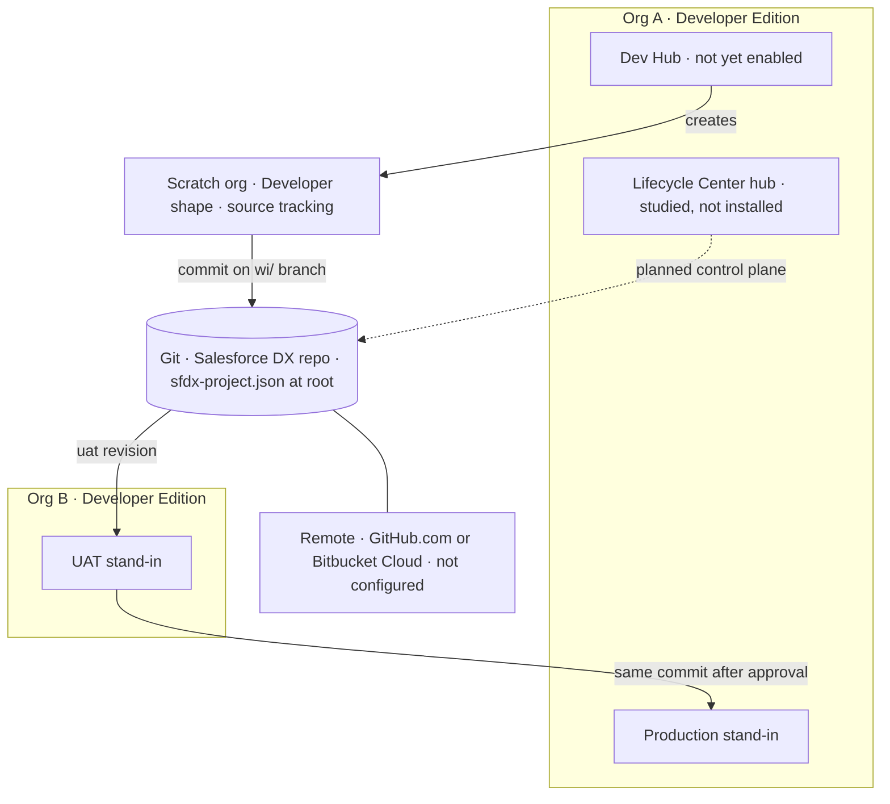
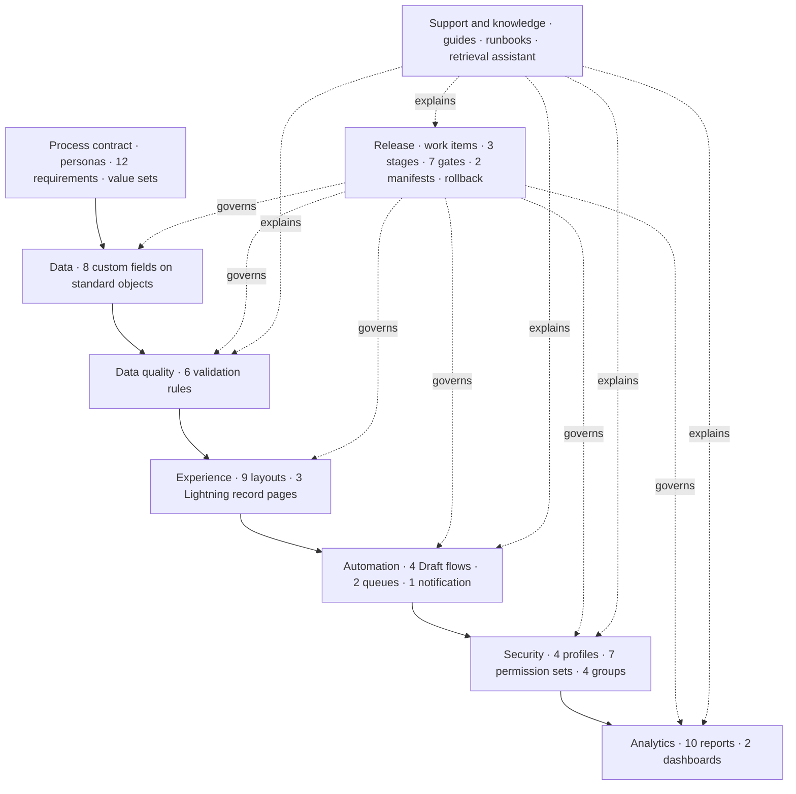
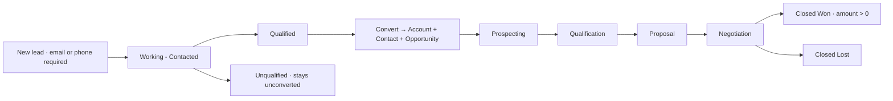
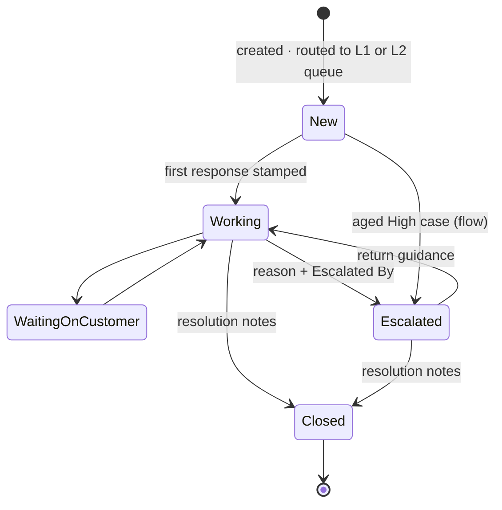
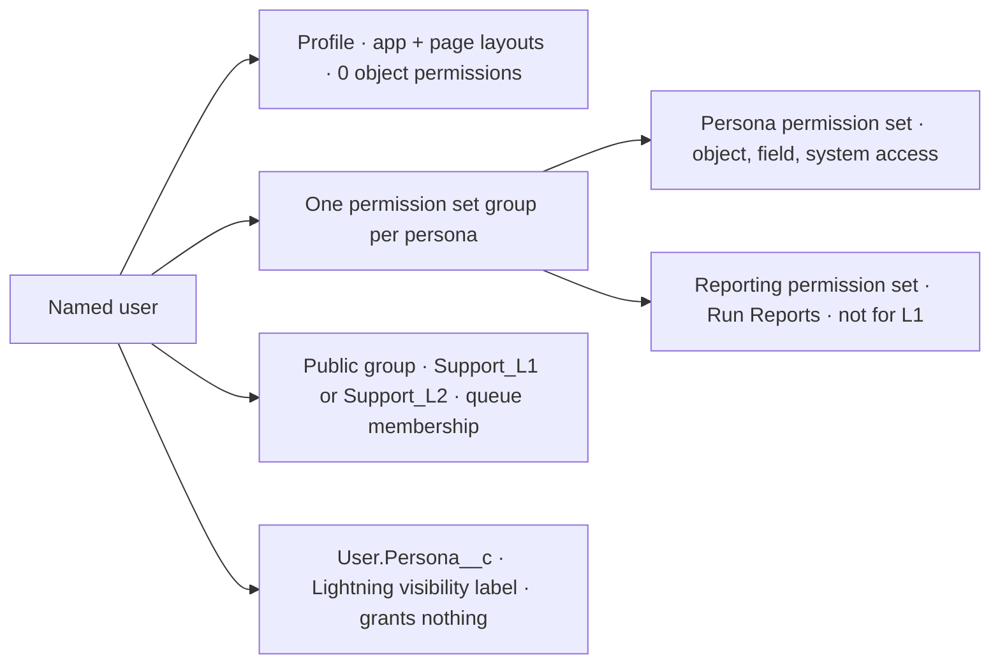
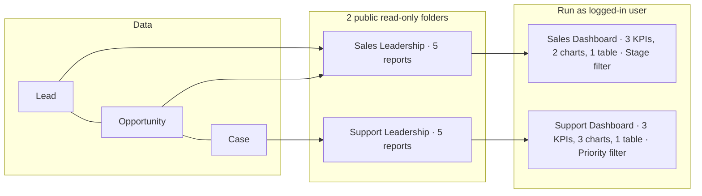
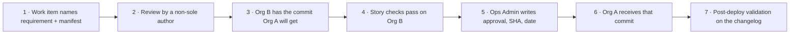
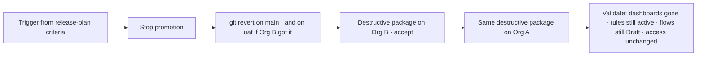
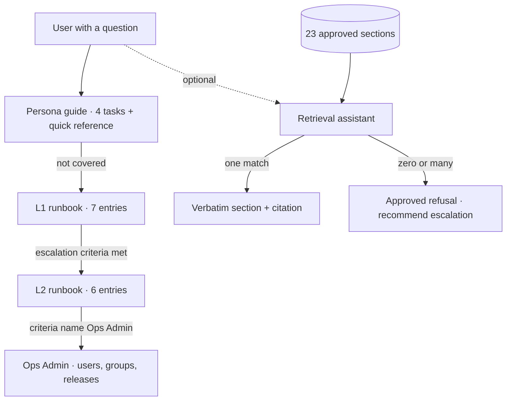

# Architecture

**Salesforce Org Operations & Release Management** · version 1.0 · 10 November 2026

This document describes how the project fits together: the environments, the operating process, the data, the automation, the security, the analytics, the release path, and the support and knowledge layer. Component-level specifications are in [TECHNICAL_DESIGN.md](TECHNICAL_DESIGN.md).

> **Status of everything below.** The Salesforce metadata is **Implemented** as DX source and has **not** been deployed. The release path is **Documented** and has not been executed. Lifecycle Center and Flosum were **Studied**: Lifecycle Center isn't installed, and Flosum access is Not Executed. No org is connected.

---

## 1. Architectural principles

| # | Principle | How it shows up |
| --- | --- | --- |
| P1 | **Git is the source of truth** | Every promotion deploys a known commit. No org-to-org copying, no change sets |
| P2 | **Fit the edition, don't pretend** | Two Developer Edition orgs and scratch orgs. No sandbox, no customer production org, no Enterprise features |
| P3 | **Standard first** | Standard Lead, Opportunity, Case, and report types. Custom fields only where a story has nowhere to store data. No custom objects, no Apex |
| P4 | **Access follows the job, not the page** | Profiles carry the app and layouts. Permission sets carry access. One group per persona |
| P5 | **Enforce at the moment it matters** | Fields stay optional. Validation rules require them only for the status that needs them |
| P6 | **Fail safe and visible** | Flows treat a missing user or queue as a handled outcome that leaves the record unchanged |
| P7 | **Separate deploy from delete** | Rollback is a revert commit plus an explicit destructive list, rehearsed on UAT first |
| P8 | **Advise, never act** | The assistant quotes one approved page or refuses. It has no write path to Salesforce |

## 2. Environment topology



| Environment | Edition | Roles | Login host | Key limits |
| --- | --- | --- | --- | --- |
| **Org A** (`org-a`) | Developer Edition | Production stand-in, Dev Hub, Lifecycle Center hub | `login.salesforce.com` | 2 CRM licenses, 5 MB data, 15,000 API calls a day, no source tracking |
| **Org B** (`org-b`) | Developer Edition | UAT stand-in | `login.salesforce.com` | Same limits. Not a sandbox of Org A |
| **Scratch** (`scratch`) | Developer scratch org | Development | Issued at creation | 500 MB data, 7-day default life, 2 user licenses, source tracking on |

**Why this shape.** Developer Edition orgs can't create sandboxes and don't support source tracking. Scratch orgs always support it, so they're the only workable development environment. Org B can't be refreshed from Org A, and change sets only travel between a production org and its sandboxes. So every hop is an explicit metadata deploy of a git revision.

**Open architectural check.** Lifecycle Center normally uses sandboxes as non-scratch stages. Whether an unrelated Developer Edition org (Org B) can be attached as a UAT stage is untested. The fallback is documented: deploy the same commit to Org B with the CLI, and record that Lifecycle Center didn't perform that hop.

## 3. Logical layers



## 4. Process architecture

### 4.1 Sales lifecycle



- **Gate 1:** `Lead_Requires_Email_Or_Phone` on every lead save.
- **Gate 2:** `Lead_Convert_Requires_Qualified` uses `PRIORVALUE(Status)`, because the convert action itself writes Closed - Converted.
- **Gate 3:** `Opportunity_Closed_Won_Requires_Amount` blocks a won deal without a positive amount. Closed Lost and open stages can still be saved with a blank amount.
- **Routing:** Lead Assignment maps Product Interest to a named owner placeholder (Draft).

### 4.2 Case lifecycle



The diagram shows the main paths. The full rules are:

- **First response.** Leaving New for any status stamps First Response At once, including a move straight to Waiting on Customer.
- **Escalation.** A manual escalation from any open status needs Escalation Reason and Escalated By. The Escalation flow can escalate an aged High-priority case from New, Working, or Waiting on Customer.
- **Return to L1.** An L2 return from Escalated to New, Working, or Waiting on Customer needs Return Guidance.
- **Close.** Closing from any status needs Resolution Notes.

Three validation rules guard the transitions that lose information. The **Escalation** flow fills the reason and Escalated By before setting Escalated, so its own update doesn't trip the rule that guards manual escalations.

## 5. Data architecture

No custom objects, record types, or formula fields. Standard fields already required by the stories, such as stage, amount, close date, subject, priority, and origin, stay standard.

| Object | Custom fields | Value sets |
| --- | --- | --- |
| Lead | `Product_Interest__c` (restricted picklist) | Lead Status |
| Opportunity | `Next_Step__c` (text 255) | Opportunity Stage |
| Case | `First_Response_At__c`, `Escalation_Reason__c`, `Escalated_By__c` (User lookup), `Return_Guidance__c`, `Resolution_Notes__c` | Case Status, Case Type |
| User | `Persona__c` (restricted picklist, visibility label only) | none |

**Deployment caveat.** A standard value set deploy replaces the target org's values. Deploying onto an org that already has records on omitted values can fail, and the previous values were never retrieved, so the rollback drill can't restore them. New scratch orgs don't have this problem. Org A and Org B haven't been checked.

## 6. Automation architecture

| Flow | Context | Fires on | Writes | Depends on |
| --- | --- | --- | --- | --- |
| Lead Assignment | After save | Lead create, Product Interest change | Lead owner | Active user with a placeholder username |
| Case Assignment | After save | Case create only | Case owner = queue | `L1_Support` or `L2_Escalation` queue |
| First Response Tracking | **Before save** | Case status change | `First_Response_At__c` | Nothing. Same-record update, no extra DML |
| Escalation | After save + scheduled path (+1 day from CreatedDate) | Case create or update, High priority, not Escalated or Closed | Status, owner, reason, Escalated By; sends a custom notification | L2 queue, an active user with Persona = Ops Admin, `Escalation_Alert` |

**Fault design.** Each flow has a `Capture Fault` connector that sets `Outcome = Fault` and stores `$Flow.FaultMessage`. Expected gaps, such as a missing owner, queue, or Ops Admin, are handled outcomes (`OwnerNotFound`, `QueueNotFound`, `NoOpsAdmin`) that don't modify the record. A flow never writes an invalid owner ID, and it never saves a status the validation layer would reject.

**Activation policy.** All four flows are Draft and deploy as Draft. Activation is a separate work item, run on UAT first. Loading the synthetic data must happen with the flows Draft, because an active Lead or Case Assignment flow would overwrite the loaded owners.

## 7. Security architecture



| Persona group | Contains | Distinguishing grants |
| --- | --- | --- |
| Sales Rep | `Sales_Rep`, `Reporting_Sales` | Lead and Opportunity create, read, edit. No Case |
| Support Agent L1 | `Support_L1` | Case create, read, edit. No reports, no transfer, no delete |
| Support Lead L2 | `Support_L2`, `Reporting_Support` | Case read, edit, View All. Transfer Cases. Opportunity read |
| Ops Admin | `Ops_Admin`, `Reporting_Admin` | Create, read, edit, delete and View All on business objects. Manage Users, Customize Application. **No Modify All Data** |

**Four independent grants**, which people often confuse:

1. **Profile:** which app and layout the user sees.
2. **Permission set group:** what the user may do.
3. **Public group:** which queue the user is in.
4. **Persona label:** which Lightning guidance shows.

The L1 and L2 runbooks explain each of these separately, because a support ticket like "I can't see the queue" is usually the third grant, not the second.

**Record visibility.** Intended org-wide defaults are Private for Lead, Opportunity, and Case, and Public Read Only for Account and Contact. These are documented and not deployed. View All on L2 cases and on Ops Admin objects is explicit in the permission sets.

**Secrets.** `.gitignore` excludes `.sf/`, `.sfdx/`, auth files, keys, and `.env`. The org registry holds aliases and roles only. Every login is a named user, and shared passwords are out of bounds.

## 8. Analytics architecture



| Decision | Rationale |
| --- | --- |
| Standard report types only (`Opportunity`, `CaseList`, `LeadList`) | No report-only objects or fields to maintain |
| Pipeline By Stage scoped to the **running user** | REQ-009 asks for *my* pipeline. Even Ops Admin sees only their own rows |
| Public, read-only folders | A deploy doesn't need a user ID in the folder share. Access is the Run Reports permission |
| L1 excluded by permission, not by folder | A private folder would hide the intent. The missing permission states it |
| Dashboards run as the logged-in user | Numbers follow the viewer's sharing. No elevated "run as" user |
| Hand-checked expected values | A reviewer can verify the dashboard after a load: 221,000 open, 41.67% converted, 15 open cases, 4 escalations |

## 9. Release architecture

### 9.1 Pipeline

| Order | Stage | Branch | Org | Owner of the hop |
| --- | --- | --- | --- | --- |
| 1 | Development | `wi/WI-00n-slug` (cut from `uat`) | Scratch org from Org A | Builder |
| 2 | UAT | `uat` | Org B | Lifecycle Center if the stage attaches, otherwise the CLI on the same commit |
| 3 | Production stand-in | `main` | Org A | Ops Admin, after written approval |

No force push, no direct commit to `main`. A Lifecycle Center project has one pipeline, so the project defines one pipeline with three stages. Any default stage that assumes a sandbox is removed.

### 9.2 Gates



A skipped gate is a **failed promotion**, not a rollback. Rollback starts only from the criteria in the release plan.

### 9.3 Packaging

| Package | Members | Contents | Rule |
| --- | ---: | --- | --- |
| Release 1 | 61 | Process, data, rules, layouts, pages, flows and tests, queues, groups, notification, profiles, all 7 permission sets, 4 groups | No Report or Dashboard members. The reporting sets ship here because the groups reference them |
| Release 2 | 16 | 10 reports, 2 dashboards, 2 report folders, 2 dashboard folders | Only Report and Dashboard members. Deploys after Release 1 passes |
| Inventory | 77 | `manifest/package.xml` | Never used for an unscoped promotion |

### 9.4 Rollback



The destructive list removes only the Release 2 reports, dashboards, and folders. It never removes standard value sets, fields, flows, profiles, or permission sets.

## 10. Support and knowledge architecture



| Property | Design |
| --- | --- |
| Corpus | Only `docs/user-guides/` and `docs/runbook/`. Design notes are deliberately excluded |
| Unit of knowledge | A `##` section with a stable ID, such as `L2:Release Failures`, and a mandatory `Keywords:` line |
| Matching | Lower-cased substring match of keyword phrases. Answer only on exactly one matching section |
| Generation | None. The answer is the section body, copied verbatim |
| Safety | No Salesforce client, subprocess, or HTTP call. A test asserts their absence. Every reply carries an advisory banner |
| Quality bar | 30-question set: 20 covered, 10 that must refuse. Result 20/20, 10/10, 0 hallucinations |

## 11. Traceability architecture

Every requirement can be followed in both directions:

```
REQ-007 ─► Case.Escalation_Reason__c, Case.Escalated_By__c, Case_Escalation_Requires_Reason,
           Escalation flow, L2_Escalation queue
        ─► Release 1 (flow, queue) + Release 2 (Escalations_By_Priority report)
        ─► validate-m3.ps1, validate-m4.ps1
        ─► Support Dashboard · Escalations KPI (expected 4)
        ─► SupportAgent:Escalate a Case · L2:Flow Faults
```

The tables are in `docs/requirement_traceability.md` (requirement → metadata → release → validation, and requirement → flow → report → dashboard).

## 12. Architecture decisions

| ID | Decision | Alternatives considered | Consequence |
| --- | --- | --- | --- |
| AD-01 | Org A is production stand-in, Dev Hub, and Lifecycle Center hub | A third org as Dev Hub | Fewer orgs to keep active. Release admin and scratch-org admin share one org |
| AD-02 | Org B as UAT via explicit deploy | A sandbox (not available), change sets (not possible) | UAT is a second org that can't be refreshed. Stage attachment is an open check |
| AD-03 | Path B: Lifecycle Center + git | Path A: Flosum | Flosum stays out until a real tenant exists. Nothing claims a Flosum pipeline |
| AD-04 | Access on permission sets, profiles as shells | Access on cloned profiles | A reporting set was added to three groups in M4 without touching a profile |
| AD-05 | Four Draft flows, activation by work item | Deploy active | Safe synthetic load. Routing and stamping don't run until a release says so |
| AD-06 | Validation rules for conditional requirements | Required fields | Earlier statuses still save. The requirement fires only on the transition |
| AD-07 | Two release packages | One unscoped deploy | Reporting can be removed without touching the operating process |
| AD-08 | Revert + destructive list for rollback | Redeploy the previous tree | An upsert can't delete. Removal is explicit and rehearsed on UAT |
| AD-09 | Retrieval-only assistant with hard refusal | A generative model | No invented click paths. Lower recall on paraphrased questions, accepted on purpose |
| AD-10 | No Service Cloud-license features | Entitlements, Omni-Channel | Stays inside the documented license set (0 Service Cloud users) |

## 13. Architectural risks

| Risk | Likelihood | Mitigation in the design |
| --- | --- | --- |
| Org B can't be a Lifecycle Center stage | Unknown | CLI deploy of the same commit, with the limitation recorded |
| Org A deactivated after a year of inactivity, taking the Dev Hub and scratch orgs | Low if operated | Login cadence on the operator checklist |
| Standard value set deploy replaces live picklist values | Medium on a used org | Deploy to a fresh scratch org first. Not covered by the rollback drill |
| API budget spent by retry loops | Medium during first deploys | Checklist item to stop retries as calls approach 15,000 |
| Four personas on two CRM licenses | Certain | Sequenced UAT, or switching groups and Persona on one extra user |
| Public report folders | Low | Run Reports is the control. Anyone later given Run Reports can open the folders |
| Escalation scheduled path not covered by a flow test | Medium | Same decision as the tested immediate path. Verify in UAT before activation |
