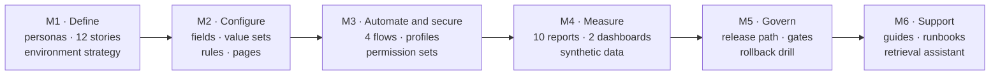

# Case Study

## Operating a Sales and Support Org Without Sandboxes: Personas, Access, Reporting, and Release Governance on Salesforce Developer Edition

**Engagement type:** Portfolio project (self-directed) · **Practice area:** Salesforce functional operations, Sales Cloud and Service Cloud administration, release management · **Author:** Nilesh P Raghavan · **Date:** 10 November 2026

> **Scope of evidence.** This case study describes a design that was built as Salesforce DX source and documented as an operating process. It hasn't been deployed to an org. Outcomes are stated as deliverables and locally verified results, not business impact measured in a live org.

---

## 1. Situation

A small company runs one sales motion and one support motion on Salesforce. Four kinds of people use the org:

- **Sales Reps** qualify leads and manage opportunities.
- **Support Agents (L1)** take customer requests.
- **Support Leads (L2)** handle escalations.
- **An Ops Admin** keeps the org configured, secure, and releasable.

The environment is deliberately constrained: **two free Salesforce Developer Edition orgs** and the scratch orgs one of them can create. There is no sandbox, no Enterprise org, no customer production org, and no paid DevOps tooling. That's the reality for a lot of learning, pre-sales, and early-stage environments. It's also a strict test of operational discipline, because none of the usual safety nets exist.

## 2. Complication

The symptoms are familiar to anyone who has supported a growing org:

| Symptom | Underlying cause |
| --- | --- |
| Pipeline reviews argue about what "Proposal" means | No single stage contract |
| Forecasts include opportunities that were never real | Leads converted before qualification |
| Escalations arrive at L2 with no reason and no previous owner | Escalation is a conversation, not a record |
| Cases bounce back to L1 without instructions, or close with no resolution | Notes are optional at exactly the wrong moment |
| Agents can change records their job doesn't need | Access lives on cloned admin profiles |
| Leaders get numbers from spreadsheet exports | No requirement-driven reports |
| Changes reach the "real" org with no record of what or why | No promotion path, no approvals, no rollback plan |
| The same how-to questions repeat, and quick answers invent click paths | Procedures are tribal knowledge |

On top of these, Developer Edition removes the standard fixes:

- No sandboxes means no refresh and no change sets between orgs.
- Org-level source tracking isn't available.
- Two CRM licenses must cover four roles.
- Zero Service Cloud user licenses rules out Entitlements, Omni-Channel, and similar features.

## 3. Key question

**How do you run a controlled, auditable sales and support operation, and a controlled release process, using only what Developer Edition actually provides, without overstating what was proven?**

## 4. Approach

The work followed six milestones. Each one ends with a validation script and an explicit statement of what wasn't executed.

### Principle 1: Write the contract before the configuration

Four personas and twelve user stories were written first, each with acceptance criteria, a priority, and a persona. Two contracts came out of that work:

- **Process contract:** the stage path, lead statuses, case statuses, priority and origin values, and two named queues.
- **Access contract:** what each persona can create, read, edit, or never touch.

Everything later traces back to a REQ ID.

### Principle 2: Design around the edition, not around a diagram

| Need | Typical answer | Developer Edition answer used here |
| --- | --- | --- |
| Development environment | Developer sandbox | Scratch org from Org A's Dev Hub. The only source-tracked option |
| UAT | Partial or full sandbox | **Org B**, a second, unrelated Developer Edition org that receives explicit deploys |
| Production | Customer production org | **Org A** as a clearly labelled *production stand-in* |
| Promotion | Change sets | Git revision → metadata deploy. Change sets can't link unrelated orgs |
| Release tooling | Commercial DevOps product | **Lifecycle Center** (studied, documented for M5) + git. **Flosum access Not Executed**, so it's kept out entirely |

### Principle 3: Put access on permission sets, not profiles

Profiles became minimum-access shells that carry only the app and page layouts, with zero object permissions. Business access lives on four persona permission sets plus three reporting sets, bundled into one permission set group per persona. The proof of the design came in M4. Adding reporting access meant adding a set to three groups. No profile was cloned and no layout assignment was rebuilt.

### Principle 4: Enforce information at the transition that needs it

Fields stay optional, and validation rules require them only at the transition that would otherwise lose information. An escalation needs a reason and the escalating user. A return to L1 needs guidance. A close needs resolution notes. A conversion needs a prior status of Qualified. A Closed Won deal needs a positive amount.

### Principle 5: Automate defensively

Four record-triggered flows handle lead routing, case routing, first-response stamping, and age-based escalation. Each has a fault path. Each treats a missing owner, queue, or admin as a *handled outcome* that leaves the record untouched. All four ship as **Draft**, and activation is its own work item.

### Principle 6: Advise, never act

The support layer is a reading path: persona guide → L1 runbook → L2 runbook → Ops Admin. The assistant in front of it retrieves one approved section verbatim or refuses. It has no route to change Salesforce.

## 5. Solution

### 5.1 Operating process

- **Sales:** One six-stage path. Conversion only from Qualified. Email or phone required on every lead. Closed Won requires an amount greater than zero. Product Interest drives lead routing.
- **Service:** Five case statuses on standard Case. New cases route by priority and type to the **L1 Support Queue** or the **L2 Escalation Queue**. The first status change away from New stamps **First Response At** once. High-priority cases still open after one day escalate automatically to L2, with the reason and Escalated By filled and the Ops Admin notified.

### 5.2 Access model

| Persona | One group | What it unlocks | What it deliberately withholds |
| --- | --- | --- | --- |
| Sales Rep | Sales_Rep + Reporting_Sales | Own leads and opportunities, personal pipeline report | Cases, deletes, setup |
| Support Agent L1 | Support_L1 | Own and L1-queue cases, escalation fields | Reports, transfers, deletes, resolution and guidance fields |
| Support Lead L2 | Support_L2 + Reporting_Support | All cases (View All), transfers, guidance and resolution, backlog reports | Deletes, production approval, user admin |
| Ops Admin | Ops_Admin + Reporting_Admin | Business-object admin, users, setup, report and dashboard management | **Modify All Data** |

### 5.3 Leadership reporting

There are ten reports and two dashboards, all running as the logged-in user.

- **Sales Dashboard:** open pipeline value, conversion rate, deals closing this month, pipeline by stage, leads by source.
- **Support Dashboard:** open cases, escalations, hours to first response, cases by priority and status, cases closed by agent.

A 66-row synthetic dataset comes with hand-counted expected values, so the first live render can be checked against a known answer.

### 5.4 Release governance

The release path is documented as **Path B: Lifecycle Center + git**. It has three stages (scratch → Org B → Org A), three branch levels (`wi/*` → `uat` → `main`), and **seven recorded gates**. The final gate is a written Ops Admin approval with the commit SHA.

The content ships as two separable packages:

- **Release 1**, the operating process and access model, 61 members.
- **Release 2**, the leadership reporting, 16 members.

Rollback is a `git revert` plus an explicit destructive list for Release 2, accepted on Org B before Org A. It's rehearsed as a tabletop drill.

### 5.5 Support and knowledge

The support layer has two persona guides (four one-page tasks each, plus a quick reference) and the L1 and L2 runbooks (seven and six entries). That makes **23 procedure sections**, each with a stable ID. The retrieval assistant answers from those 23 sections only.

## 6. Results

| Deliverable | Result | Evidence label |
| --- | --- | --- |
| Requirements traced end to end | 12 of 12 mapped to metadata, release package, and validation script | Implemented + Documented |
| Configuration | 8 fields, 4 value sets, 6 validation rules, 9 layouts, 3 record pages | Implemented (source) |
| Automation | 4 Draft flows with fault paths, 7 flow tests, 2 queues | Implemented (source) |
| Security | 4 profiles with 0 object permissions, 7 permission sets, 4 groups, 0 grants of Modify All Data | Implemented (source) |
| Analytics | 10 reports, 2 dashboards, 4 hand-checked metrics (221,000 · 41.67% · 15 · 4) | Implemented (source). Values not observed |
| Release governance | 3 stages, 7 gates, 2 manifests, destructive list, tabletop rollback | Documented |
| Support content | 23 procedure sections | Implemented (documents) |
| Assistant quality | **20/20** correct answers · **10/10** correct refusals · **0** hallucinations · 100% citation accuracy | Implemented, evaluated locally and reproduced |
| Repository validation | validate-m1 to m5 recorded PASS (85 / 140 / 83 / 80 / 72 checks). Assistant unit tests 5/5 | Recorded 10 November 2026 |

### What these results do and don't show

They **show** that the configuration is complete and internally consistent: the counts haven't drifted, the flows are Draft with fault paths, no grant is too broad, and every requirement is traced. They show that the release process is fully specified, and that the assistant returns approved text or refuses on a fixed question set.

They **don't show** behaviour in a live org. Nothing has been deployed, no dashboard has been rendered, no flow has run, and no promotion has a deploy ID. Those are the first items on the roadmap.

## 7. Trade-offs accepted

| Decision | Benefit | Cost |
| --- | --- | --- |
| Org A doubles as Dev Hub and production stand-in | Two orgs are enough | Release administration and scratch-org administration share one org |
| Flows ship Draft | Safe data loads and no surprise routing | Routing and stamping don't happen until a release activates them |
| Public, read-only report folders | No user IDs in folder shares | Anyone later given Run Reports can open the support reports |
| Retrieval with hard refusal | No invented procedures | Paraphrased questions that miss a keyword phrase are refused |
| Standard Case only | Stays inside the documented license set | No Entitlements, milestones, or Omni-Channel |
| Standard value sets as the process contract | One meaning for every stage and status | A first deploy replaces existing values on a used org |

## 8. Lessons for practitioners

1. **The edition is a design input.** Writing the limits down first (no sandboxes, two CRM licenses, zero Service Cloud licenses, scratch-only source tracking) removed whole categories of rework.
2. **Profiles for the page, permission sets for the job.** The M4 reporting change proved the value: one set added to three groups.
3. **Four different grants get mistaken for one.** Profile, permission set group, queue membership, and a persona label solve different problems. The runbooks name each one, because support tickets confuse them.
4. **A metadata deploy is an upsert.** Rollback needs a revert *and* a destructive list, rehearsed on UAT, and it can't restore standard picklist values that were never retrieved.
5. **Say what wasn't executed.** Every milestone ends with a "not executed" list, and the validation scripts fail if the changelog claims an execution that didn't happen.

## 9. Next steps

1. Install the CLI and authorize Org A and Org B. Confirm the license counts on Company Information.
2. Enable Dev Hub. Turn on Lifecycle Center. Connect GitHub.com or Bitbucket Cloud. Build the one-project, three-stage pipeline.
3. Record whether Org B can be attached as a stage. If not, use a CLI deploy of the same commit and write down the limitation.
4. Promote Release 1, then Release 2, through all seven gates.
5. Load the synthetic data with the flows still Draft, render the dashboards, and compare against the four hand-checked metrics.
6. Activate flows one work item at a time, UAT first.

Full plan: [ROADMAP.md](ROADMAP.md).
