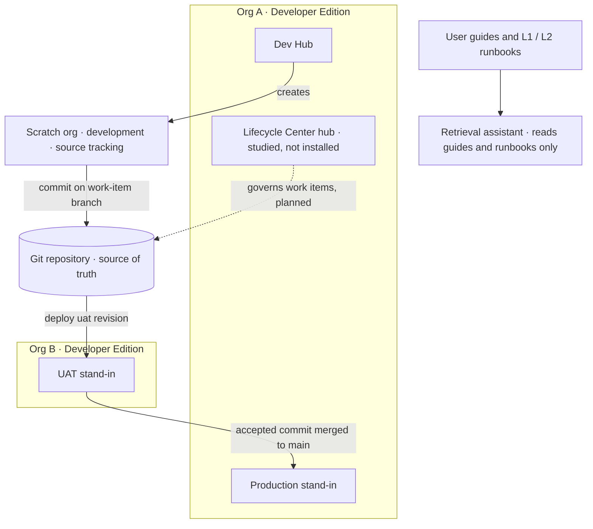
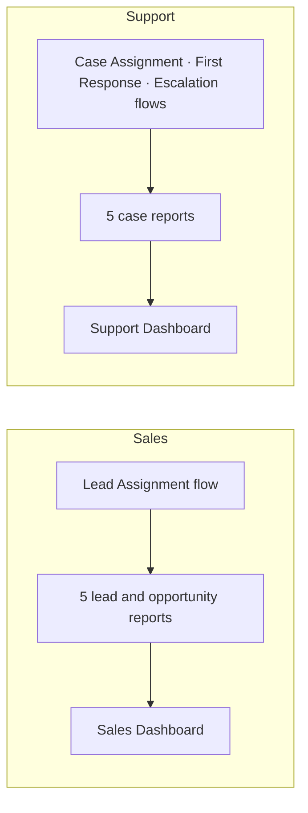
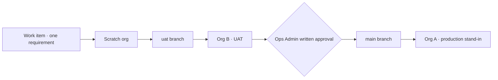
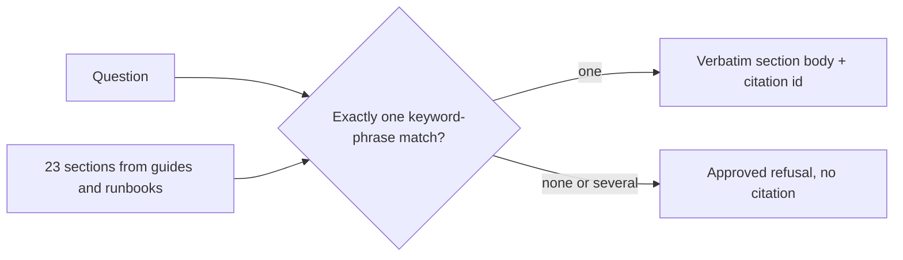

# Salesforce Org Operations & Release Management

**Functional operations for Sales Cloud and Service Cloud on Developer Edition: personas, access, case and pipeline processes, leadership reporting, release governance, support runbooks, and an advisory assistant that refuses to guess.**

`Salesforce DX · API 68.0` · `Developer Edition only` · `6 milestones complete in source` · `Not deployed to any org`

| 4 personas | 12 requirements | 8 custom fields | 6 validation rules | 4 flows | 7 permission sets |
|:---:|:---:|:---:|:---:|:---:|:---:|
| **4 permission set groups** | **10 reports** | **2 dashboards** | **23 procedure sections** | **20/20 correct answers** | **10/10 correct refusals · 0 hallucinations** |

> **Evidence boundary.** Every item in this repository is labelled **Implemented** (Salesforce DX source or Python code in the repository), **Documented** (a written process that has not been run), or **Studied** (read from public documentation). The metadata has **not** been deployed. Org A and Org B are not connected, Dev Hub is not enabled, and no scratch org has been created. There is no production org, no Enterprise org, and no sandbox. Lifecycle Center was studied and the release process was documented for it, but it was not installed. Flosum access is **Not Executed**.

---

## Overview

This is a portfolio project in Salesforce functional operations. It shows how an operations admin would run a small sales and support process across more than one org, with git as the source of truth and with every promise written down before it is built.

It answers four questions a Salesforce operations team faces:

1. **Who does what?** Four personas and twelve user stories set the access contract and the process contract.
2. **What does the org enforce?** Fields, value sets, validation rules, flows, and permission sets turn those contracts into configuration.
3. **How does leadership see it?** Ten reports and two dashboards, each tied to a requirement, with expected values counted by hand from a synthetic dataset.
4. **How does a change move safely, and who helps a confused user?** A gated release process, a tabletop rollback, persona guides, L1 and L2 runbooks, and a retrieval assistant that quotes one approved page or refuses.

## Project Purpose

Show the work of a Salesforce operations admin across Sales Cloud and Service Cloud administration, with release discipline that fits what Developer Edition actually provides.

The **business scope** covers four people. A Sales Rep qualifies leads and manages a pipeline. A Support Agent L1 handles cases. A Support Lead L2 takes escalations. An Ops Admin controls access and releases.

The **technical scope** is the configuration and release discipline that make those jobs possible on free Developer Edition orgs. It uses standard objects only, adds no Apex, and keeps every claim inside the edition's limits.

## Scope

| In scope | Status |
| --- | --- |
| Personas, requirements, environment strategy, DX layout | Implemented and documented (M1) |
| Fields, standard value sets, validation rules, layouts, Lightning record pages | Implemented in source (M2) |
| Flows, flow tests, queues, minimum-access profiles, permission sets and groups, security matrix | Implemented in source (M3) |
| Reports, dashboards, synthetic data, hand-checked metrics | Implemented in source (M4) |
| Release governance, release plan, checklists, changelog, release manifests, tabletop rollback | Documented (M5) |
| User guides, L1 and L2 runbooks, retrieval assistant and its evaluation | Implemented and evaluated locally (M6) |

| Out of scope | Reason |
| --- | --- |
| Deploying to Org A, Org B, or a scratch org | The Salesforce CLI is not installed in the build workspace and no org is connected |
| Sandboxes, a customer production org, an Enterprise org | Developer Edition provides none of these |
| Flosum pipelines | Access is Not Executed. There is no tenant |
| Lifecycle Center configuration | Studied and documented for M5. Not installed |
| Service Cloud features that need a Service Cloud user license | Developer Edition lists 0 such licenses. Case management uses standard Case |
| Apex | Not needed. The release review rejects Apex in the manifests |

## Current Status

**Version 1.0 is complete as a source portfolio.** Milestones M1 through M6 are in the repository. Nothing has been deployed.

| Item | Status |
| --- | --- |
| Org A (production stand-in, Dev Hub, Lifecycle Center hub) | Not connected |
| Org B (UAT stand-in) | Not connected |
| Scratch org | Not created |
| Dev Hub | Not enabled |
| Lifecycle Center | Studied. Process documented in M5. Not installed or configured |
| Flosum | Not Executed |
| Metadata | M2 to M4 source in the repository. Not deployed. Flows are Draft. Dashboards not rendered |
| Synthetic data | In `data/synthetic/`. Not loaded |
| Release 1 and Release 2 | Manifests defined. Outcome Not executed. Rollback status Not required |
| Git remote | Not configured |
| Retrieval assistant | Evaluated locally: 20/20 correct answers, 10/10 correct refusals, 0 hallucinations |

## Architecture



| Environment | Role | Why |
| --- | --- | --- |
| **Org A** | Production stand-in, Dev Hub, Lifecycle Center hub | The last org a change reaches. Not a customer production org |
| **Org B** | UAT stand-in | A second, unrelated Developer Edition org. Not a sandbox, so it can't be refreshed from Org A and change sets can't link the two |
| **Scratch org** | Development | Only scratch orgs support source tracking. Developer Edition orgs don't |
| **Git** | Source of truth | Every promotion deploys a known commit, never an org-to-org copy |

The full layer-by-layer design is in [ARCHITECTURE.md](ARCHITECTURE.md). The component specification is in [TECHNICAL_DESIGN.md](TECHNICAL_DESIGN.md).

## Personas

Four roles share two Salesforce CRM licenses, so they are **roles, not simultaneous logins**. UAT sequences them.

| Persona | Owns | Can't do | Permission set group |
| --- | --- | --- | --- |
| **Sales Rep** | Own leads and opportunities: qualify, convert, keep the stage path and next step current | Read or edit cases, delete leads or opportunities, open Setup | `Sales_Rep` = Sales_Rep + Reporting_Sales |
| **Support Agent L1** | Cases they own or that sit in the L1 Support Queue: create, work, escalate with a reason | Delete cases, edit leads or opportunities, run team reports, transfer cases | `Support_Agent_L1` = Support_L1 |
| **Support Lead L2** | Every support case: take escalations, resolve, or return to L1 with guidance; run the backlog report | Delete cases, approve production promotion, manage users | `Support_Lead_L2` = Support_L2 + Reporting_Support |
| **Ops Admin** | Configuration, users, persona groups, release approval | Grant Modify All Data, approve their own work item as the only reviewer | `Ops_Admin` = Ops_Admin + Reporting_Admin |

The 12 requirements (REQ-001 to REQ-012) cover sales pipeline, lead qualification, case management, escalation, reporting, and access control. Ten are High priority and two are Medium. They are in `docs/requirements.md` and traced to metadata in `docs/requirement_traceability.md`.

## Configuration Summary

**Process contract**, stored as standard value sets:

| Value set | Values |
| --- | --- |
| Opportunity Stage | Prospecting (10%) → Qualification (20%) → Proposal (50%) → Negotiation (80%) → Closed Won (100%) / Closed Lost (0%) |
| Lead Status | Open - Not Contacted → Working - Contacted → Qualified / Unqualified · Closed - Converted (written by the convert action) |
| Case Status | New → Working → Waiting on Customer → Escalated → Closed |
| Case Type | Question (default), Problem, Feature Request (added so case routing can use type) |

**Eight custom fields** store only what the standard objects can't:

| Field | Type | Requirement |
| --- | --- | --- |
| `Lead.Product_Interest__c` | Restricted picklist | REQ-003 |
| `Opportunity.Next_Step__c` | Text (255) | REQ-001 |
| `Case.First_Response_At__c` | Date/Time, stamped once by flow | REQ-006 |
| `Case.Escalation_Reason__c` | Long text (1,000) | REQ-007 |
| `Case.Escalated_By__c` | Lookup (User) | REQ-007 |
| `Case.Return_Guidance__c` | Long text (1,000) | REQ-008 |
| `Case.Resolution_Notes__c` | Long text (1,000) | REQ-008 |
| `User.Persona__c` | Restricted picklist. A Lightning visibility label, **not** an access grant | REQ-011, REQ-012 |

Nine persona layouts and three Lightning record pages (Lead, Opportunity, Case) show each role only the fields it needs. Dynamic visibility on record state and on `User.Persona__c` drives the pages.

## Validation Rules

Six active rules. Each rule allows the normal working path and blocks only the save the requirement forbids. The custom fields stay optional, so earlier statuses still save.

| Rule | Object | Blocks | Formula logic |
| --- | --- | --- | --- |
| `Lead_Requires_Email_Or_Phone` | Lead | A lead with no email and no phone | `AND(ISBLANK(Email), ISBLANK(Phone))` |
| `Lead_Convert_Requires_Qualified` | Lead | Converting any lead that wasn't Qualified | `AND(IsConverted, NOT(ISPICKVAL(PRIORVALUE(Status), "Qualified")))` |
| `Opportunity_Closed_Won_Requires_Amount` | Opportunity | Closed Won with a blank, zero, or negative amount | `AND(ISPICKVAL(StageName,"Closed Won"), OR(ISBLANK(Amount), Amount <= 0))` |
| `Case_Escalation_Requires_Reason` | Case | Escalated without a reason and an escalating user | Status = Escalated and either field blank |
| `Case_Close_Requires_Resolution` | Case | Closed without resolution notes | Status = Closed and notes blank |
| `Case_Return_Requires_Guidance` | Case | Sending an escalated case back to L1 without guidance | Prior status Escalated, new status New, Working, or Waiting on Customer, and guidance blank |

Each rule has three passing and three failing manual examples in `docs/test-cases.md` (36 in total). They haven't been run in an org.

## Metadata Categories

| Category | Count | Members |
| --- | ---: | --- |
| Custom fields | 8 | Listed above |
| Standard value sets | 4 | `LeadStatus`, `OpportunityStage`, `CaseStatus`, `CaseType` |
| Validation rules | 6 | Listed above |
| Page layouts | 9 | Sales Rep (Lead, Opportunity), L1 (Case), L2 (Case, Opportunity), Ops Admin (Lead, Opportunity, Case, User) |
| Lightning record pages | 3 | `Lead_Record_Page`, `Opportunity_Record_Page`, `Case_Record_Page` |
| Record-triggered flows | 4 | All **Draft** |
| Flow tests | 7 | Metadata only. Not run |
| Queues and public groups | 2 + 2 | `L1_Support`, `L2_Escalation`; `Support_L1`, `Support_L2` |
| Custom notification type | 1 | `Escalation_Alert` |
| Profiles | 4 | Minimum-access shells with **zero** object permissions |
| Permission sets | 7 | 4 persona sets + 3 reporting sets |
| Permission set groups | 4 | One per persona |
| Reports | 10 | 5 Sales Leadership + 5 Support Leadership |
| Dashboards | 2 | Sales Dashboard, Support Dashboard |

`manifest/package.xml` lists all 77 members at API 68.0. There is no Apex in the package.

## Flows

Four record-triggered flows, all **Draft**. Each has a `Capture Fault` path. A missing user, queue, or Ops Admin is a *handled outcome* that leaves the record unchanged, not a platform fault.

| Flow | Trigger | What it does | Handled outcomes |
| --- | --- | --- | --- |
| **Lead Assignment** | After save · Lead create, or Product Interest changes | Routes the lead to a named owner placeholder by Product Interest | Assigned · OwnerNotFound · Fault |
| **Case Assignment** | After save · Case create only | High + Problem, Feature Request, or blank type → L2 Escalation Queue. High + Question, Medium, Low → L1 Support Queue | Assigned · QueueNotFound · Fault |
| **First Response Tracking** | Before save · Case status changes | Stamps `First_Response_At__c` once, when status leaves New and the field is empty | Stamped · Skipped · Fault |
| **Escalation** | After save · Case create and update, High priority, not Escalated or Closed · scheduled path 1 day after CreatedDate | Escalates an aged high-priority case to the L2 queue, fills the reason and Escalated By so the validation rule passes, and notifies the Ops Admin | NotDue · QueueNotFound · NoOpsAdmin · Escalated · Fault |

Seven flow tests cover the routing branches and the stamp and skip paths. The Escalation scheduled path has no flow test. Its test covers the immediate path only.

## Security

**Business access lives on permission sets, not profiles.** The four profiles hold only the app and the page-layout assignments, with zero `objectPermissions`. A profile-only user can log in and can't create a lead, opportunity, or case. That user is the control case in persona testing.

| Permission set | Object access | System permissions |
| --- | --- | --- |
| `Sales_Rep` | Lead and Opportunity create, read, edit. Account, Contact, User read. No Case. No delete | None |
| `Support_L1` | Case create, read, edit. Account, Contact, User read. No Lead or Opportunity. No delete | None |
| `Support_L2` | Case read, edit, view all. Opportunity, Account, Contact, User read. No delete | Transfer Cases |
| `Ops_Admin` | Create, read, edit, delete with view all on Lead, Account, Contact, Opportunity, Case. User read and edit | View Setup, Customize Application, Manage Users, View All Users |
| `Reporting_Sales` / `Reporting_Support` | None | Run Reports |
| `Reporting_Admin` | None | Run Reports, create and customize reports and dashboards, manage public folders |

- **No permission set grants Modify All Data.**
- **Support Agent L1 gets no reporting set.** That keeps L1 out of the all-team support dashboard, as REQ-010 requires.
- **Queue membership is a separate grant.** The public groups `Support_L1` and `Support_L2` make someone a queue member. Assigning the permission set group doesn't.
- **`User.Persona__c` is a label.** It changes what Lightning shows. It grants nothing.
- The object, field, and system-permission matrix is in `docs/security-matrix.xlsx`. The intended org-wide defaults are Private for Lead, Opportunity, and Case, and Public Read Only for Account and Contact. They are documented but not deployed.

## Reports

Ten reports on standard report types. No report-only fields or objects were added.

| Report | Folder | Format | Requirement question |
| --- | --- | --- | --- |
| Pipeline By Stage | Sales Leadership | Summary · **scope = running user** | REQ-009: my pipeline by stage |
| Open Opportunity Value | Sales Leadership | Summary | Open amount, excluding Closed Won and Closed Lost |
| Opportunities Closing This Month | Sales Leadership | Summary | Deals with a close date in the current calendar month |
| Lead Conversion By Source | Sales Leadership | Summary + rate formula | Leads by source and the share converted |
| Conversion Rate | Sales Leadership | Summary formula | Share of all leads converted |
| Cases By Status | Support Leadership | **Matrix** (status × priority) | REQ-010: backlog with owner and opened date |
| Open Cases By Priority | Support Leadership | Summary | Open cases at each priority |
| First Response Performance | Support Leadership | Summary formula | Hours to first response: `(First Response At − Created Date) × 24` |
| Escalations By Priority | Support Leadership | Summary | Escalated cases by priority |
| Cases Closed By Agent | Support Leadership | Summary | Closed cases by owner |

## Reporting Architecture



Reports sit in two **public, read-only** folders. Access comes from the reporting permission set in each persona group, not from folder sharing, so a deploy never needs a user ID in a folder share. Sales Rep runs reports through `Reporting_Sales`, Support Lead L2 through `Reporting_Support`, and Ops Admin manages them through `Reporting_Admin`. Support Agent L1 has no reporting permission set.

## Dashboards

| Dashboard | Components | Filter |
| --- | --- | --- |
| **Sales Dashboard** | 3 KPIs (Open Opportunity Value, Conversion Rate, Closing This Month), pipeline bar chart, lead-source donut, closing-this-month table | Stage, wired to the pipeline bar and the closing table |
| **Support Dashboard** | 3 KPIs (Open Cases, Escalations, First Response hours), priority bar, status column, escalations bar, closed-by-agent table | Priority, wired to every component |

Both dashboards **run as the logged-in user**, so every number follows the viewer's sharing. Neither has been rendered in an org.

## Dashboard Strategy

Each dashboard uses the same three component kinds: KPI metrics on the top row, charts for grouped questions, and a table for the row-level question. Folders stay public and read-only so access depends on the permission set in the persona group, not on a folder share. Running as the logged-in user keeps a Sales Rep from seeing the full book through a dashboard they can open.

**Hand-checked metrics.** Two metrics per dashboard were counted by hand from `data/synthetic/` (2 accounts, 2 contacts, 24 leads, 18 opportunities, 20 cases). The dashboard value is recorded as **Not observed** because nothing was rendered.

| Dashboard | Metric | Expected value | How it was counted |
| --- | --- | ---: | --- |
| Sales | Open Opportunity Value | 221,000 | Sum of Amount on 13 rows that aren't Closed Won or Closed Lost |
| Sales | Conversion Rate | 41.67% | 10 conversion targets ÷ 24 leads |
| Support | Open Cases | 15 | Rows not Closed (High 7, Medium 4, Low 4) |
| Support | Escalations | 4 | Rows in Escalated (High 2, Medium 1, Low 1) |

## Business Insights

These figures describe the synthetic dataset, not a live org.

- **Sales:** 221,000 of open pipeline across 13 deals. A 41.67% lead conversion rate once the ten targets are converted. Web is the largest source, with 10 of 24 leads. Eleven deals close in November 2026, worth 212,000. Rep A holds 165,000 of the open amount and Rep B holds 56,000. That's why a single rep must never be compared with the full-book figure.
- **Support:** 15 open cases, 7 of them High. 4 escalations. The 16 cases that left New average **3.00 hours** to first response. 5 cases are closed.

## Release Governance

**Path B: Lifecycle Center plus git.** Path A (Flosum) isn't used because access is Not Executed. This process is **documented and not executed**.



| Stage | Branch | Environment |
| --- | --- | --- |
| Development | `wi/WI-00n-slug` | Scratch org created from Org A |
| UAT | `uat` | Org B |
| Production stand-in | `main` | Org A |

**Seven gates**, each recorded before the next step: the work item names its requirement and manifest → the diff is reviewed by someone other than the only author → Org B has the same commit Org A will receive → the story checks pass on Org B → Ops Admin writes the approval, commit SHA, and date → Org A receives that commit → post-deployment validation is written on the changelog.

| Release | Contents | Manifest | Outcome |
| --- | --- | --- | --- |
| **Release 1** · WI-001 | Operating process and access: fields, value sets, rules, layouts, record pages, Draft flows and tests, queues, groups, notification type, profiles, 7 permission sets, 4 groups | `release/manifests/release-1-package.xml` (61 members) | Not executed |
| **Release 2** · WI-002 | Leadership reporting: 10 reports, 2 dashboards, 2 folders. Depends on Release 1 | `release/manifests/release-2-package.xml` (16 members) | Not executed |

**Rollback** starts from a `git revert`, never a force push. A metadata deploy is an upsert and doesn't delete what a bad commit added, so removing Release 2 uses `release/rollback/destructiveChanges.xml`, accepted on Org B before Org A. The drill in `release/rollback-drill.md` is a **tabletop**, with its triggers, steps, validation, risks, and metadata limits written out.

The release plan, checklists, and changelog are in `release/`. The narrative is in `docs/release_management.md` and `docs/release_governance.md`.

## Runbooks

Support is a reading path. A user starts on a guide page, moves to the L1 runbook if the guide doesn't cover the symptom, then to L2 or Ops Admin as the entry directs.

| Document | Sections | Shape |
| --- | ---: | --- |
| Sales Rep guide | 4 tasks + quick reference | Steps · Expected outcome · Troubleshooting |
| Support Agent guide | 4 tasks + quick reference | Steps · Expected outcome · Troubleshooting |
| L1 runbook | 7 entries: login, MFA, record visibility, missing data, report access, dashboard access, case reassignment | Symptom · Checks · Resolution · Escalation Criteria |
| L2 runbook | 6 entries: flow faults, validation rules, permission sets, release failures, data corrections, reporting discrepancies | Symptom · Checks · Resolution · Escalation Criteria |

That's **23 procedure sections**: 10 guide sections and 13 runbook entries.

## User Support Model

| Tier | Used by | Covers | Stops at |
| --- | --- | --- | --- |
| Sales Rep guide | Sales Rep | Qualify, update pipeline, close, run my pipeline report | Cases, setup, deletes |
| Support Agent guide | Support Agent L1 | Create a case, first response, escalate, L1 limits | Team reports, transfers, resolution notes |
| L1 runbook | First support responder | Access, visibility, missing data, reports, dashboards, ownership | Permission changes, flow edits, deploys |
| L2 runbook | Support Lead L2 | Flows, rules, permission sets, releases, data, reporting | Assigning permissions, deploying, activating flows |

Ops Admin remains the only role that assigns groups, manages users, and promotes a release. Support will not invent a click path, disable MFA, share a password, grant Modify All Data, or delete records to make a report match.

## AI Helper

A **document-retrieval assistant** in standard-library Python (`helper/`). It answers a how-to question only when exactly one approved procedure section matches. It's advisory. It doesn't log in to Salesforce, change data, assign permissions, edit configuration, deploy, or trigger automation.

```bash
py -3 helper/ingest.py                              # build the 23-section index
py -3 helper/ask.py "How do I qualify a lead?"      # verbatim section + citation
py -3 helper/eval/run_eval.py                       # 30-question evaluation
py -3 -m unittest helper.tests.test_helper -v       # 5 tests
```

When no section matches, or more than one does, it gives the approved refusal:

```
This runbook does not contain
an approved answer.

Recommend escalation.
```

## AI Assistant Architecture



- `ingest.py` splits `docs/user-guides/` and `docs/runbook/` on `##` headings such as `L1:Login Problems`. Each section must start with a `Keywords:` line, or ingestion fails.
- `ask.py` lower-cases the question and counts keyword-phrase hits per section. A reply is returned **only** when exactly one section matches, and the text is that section's body, copied verbatim.
- A unit test asserts the code contains no `subprocess`, `simple_salesforce`, `sf project deploy`, or `requests.` call.

## Knowledge Management Strategy

The approved procedures are the markdown pages under `docs/user-guides/` and `docs/runbook/`. A new answer is a new section with a stable ID and a `Keywords:` line. It is never a change to the retriever. The assistant doesn't read the rest of the repository, so a fact that lives only in a design note is deliberately not an answer.

Review a new section like a support macro: one symptom, one resolution, one escalation line. Then add a covered question to `helper/eval/questions.json`, or leave the topic uncovered on purpose and expect a refusal. Re-run the tests.

## Metrics

| Metric | Value | Evidence |
| --- | ---: | --- |
| Milestones complete in source | 6 | `project_completion.md` |
| Personas / requirements | 4 / 12 | `docs/personas.md`, `docs/requirements.md` |
| Custom fields / validation rules | 8 / 6 | `force-app/main/default/objects/` |
| Flows (Draft) / flow tests | 4 / 7 | `flows/`, `flowtests/` |
| Permission sets / groups / profiles | 7 / 4 / 4 | `permissionsets/`, `permissionsetgroups/`, `profiles/` |
| Reports / dashboards | 10 / 2 | `reports/`, `dashboards/` |
| Release packages defined | 2 (61 + 16 members) | `release/manifests/` |
| Procedure sections | 23 | `helper/index.json` |
| Assistant evaluation | 30 questions: **20/20** correct answers, **10/10** correct refusals, **0** hallucinations, 100% citation accuracy | `docs/ai_helper_evaluation.md`, reproduced with `run_eval.py` |
| Recorded validation passes | validate-m1 to m5: 85, 140, 83, 80, 72 checks · helper tests 5/5 | `project_completion.md` (10 November 2026) |

A **hallucination** here means a reply whose text isn't the cited section body, or a refusal that adds text or a citation. The score shows that the retriever returns the written page or refuses. It doesn't show that anyone completed the click path in an org.

## Repository Structure

```
.
├── README.md
├── sfdx-project.json                 # API 68.0, package dir force-app
├── config/project-scratch-def.json   # Developer edition, no sample data
├── manifest/package.xml              # full inventory, 77 members
├── force-app/main/default/           # M2–M4 metadata (fields, rules, flows, security, reports, dashboards)
├── docs/                             # 25 markdown docs + security-matrix.xlsx
│   ├── user-guides/                  # Sales Rep and Support Agent guides
│   └── runbook/                      # L1 and L2 runbooks
├── data/synthetic/                   # 2 accounts, 2 contacts, 24 leads, 18 opportunities, 20 cases
├── org-ops/                          # org alias registry, no credentials
├── release/                          # plan, checklist, changelog, rollback drill, manifests
├── helper/                           # retrieval assistant, index, eval, tests
├── tests/                            # validate-m1.ps1 … validate-m6.ps1
├── showcase/                         # Next.js case-study site
├── project_completion.md · release_notes_v1.0.md · future_roadmap.md · portfolio_summary.md
```

### Validate

From the repository root (Windows PowerShell):

```powershell
powershell -NoProfile -ExecutionPolicy Bypass -File tests/validate-m1.ps1   # through validate-m6.ps1
```

## Roadmap

| Milestone | Focus | Status |
| --- | --- | --- |
| M1 | Orgs, personas, requirements, environment strategy, Flosum access assessment, Lifecycle Center notes, DX layout | Complete |
| M2 | Fields, value sets, layouts, Lightning record pages, validation rules | Complete in source |
| M3 | Flows, minimum-access profiles, permission sets and groups, queues, security matrix | Complete in source |
| M4 | Reports, dashboards, synthetic data, metric checks | Complete in source |
| M5 | Release governance for scratch org → Org B → Org A | Documented. Not executed |
| M6 | User guides, runbooks, retrieval assistant | Complete. Evaluated locally |

**Next, once Org A and Org B are real logins:** install the CLI and authorize both orgs, then enable Dev Hub. Turn on Lifecycle Center, connect GitHub.com or Bitbucket Cloud, and build the three-stage pipeline. Record whether Org B can attach as a stage. Promote Release 1 and then Release 2 using the checklists, load the synthetic data with the flows still Draft, and compare the hand-checked metrics. Full detail is in [ROADMAP.md](ROADMAP.md).

## M1 Status

Complete. Four personas, twelve requirements, environment strategy, Flosum access assessment (Not Executed), Lifecycle Center notes, DX layout, and the org alias registry.

## M2 Status

In source, not deployed. Eight fields, four standard value sets, six active validation rules with 36 manual examples, nine layouts, and three Lightning record pages.

## M3 Status

In source, not deployed. Four Draft flows with fault paths and seven flow tests, two queues and two public groups, four minimum-access profiles, four persona permission sets, four permission set groups, and the security matrix.

## M4 Status

In source, not deployed. Ten reports, two dashboards, three reporting permission sets, a synthetic dataset, and four hand-checked metrics. Dashboard values are not observed.

## M5 Status

Documented, not executed. Path B (Lifecycle Center and git). Release plan, checklists, changelog for Release 1 and Release 2, release manifests, a destructive removal list for Release 2, and a tabletop rollback drill. Flosum is Not Executed.

## M6 Status

Complete in source and evaluated locally. Two user guides, the L1 and L2 runbooks, and the retrieval assistant: 23 sections, 20/20 correct answers, 10/10 correct refusals, 0 hallucinations. The assistant made no Salesforce changes.

## Developer Edition Constraints

Figures come from Salesforce documentation cited in `docs/environment_strategy.md`. Re-check Company Information when an org is connected.

| Constraint | Value | Design consequence |
| --- | --- | --- |
| Sandboxes | None | Org B is a second Developer Edition org. No refresh, no change sets |
| Source tracking | Scratch orgs only | Development happens in a scratch org. Org A and Org B take explicit deploys |
| Dev Hub allocation | 3 active, 6 per rolling 24 hours | Throwaway environments are scarce |
| Salesforce CRM user licenses | 2 | Four personas are roles. UAT sequences logins |
| Platform / Service Cloud user licenses | 3 / 0 | Case management uses standard Case. No Entitlements, Omni-Channel, or other features that need a Service Cloud license |
| Data / file storage | 5 MB / 20 MB | The synthetic dataset stays tiny |
| API requests | 15,000 per 24 hours | Stop retry loops. A repeated failed deploy can spend the budget |
| Inactivity | Deactivation after 1 year | A deactivated Dev Hub takes its scratch orgs with it. The operator checklist sets a login cadence |
| Scratch org | 500 MB data, 50 MB files, 7-day default, 30-day maximum, 2 user licenses | Re-create from git, never from an expired org |

---

**Author:** Nilesh P Raghavan · [GitHub](https://github.com/NileshModlier) · Portfolio project, documentation dated 10 November 2026.

**Related documents:** [PROJECT_OVERVIEW](PROJECT_OVERVIEW.md) · [ARCHITECTURE](ARCHITECTURE.md) · [TECHNICAL_DESIGN](TECHNICAL_DESIGN.md) · [CASE_STUDY](CASE_STUDY.md) · [INTERVIEW_GUIDE](INTERVIEW_GUIDE.md) · [DEMO_SCRIPT](DEMO_SCRIPT.md) · [LESSONS_LEARNED](LESSONS_LEARNED.md) · [ROADMAP](ROADMAP.md) · [PROJECT_COMPLETION_REPORT](PROJECT_COMPLETION_REPORT.md) · [RELEASE_NOTES_v1.0](RELEASE_NOTES_v1.0.md)
