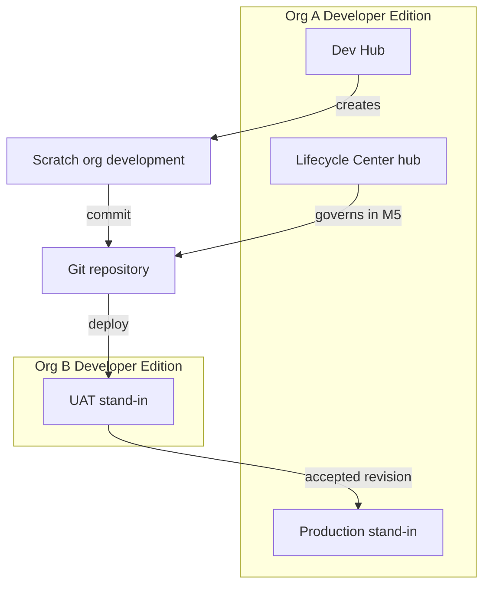
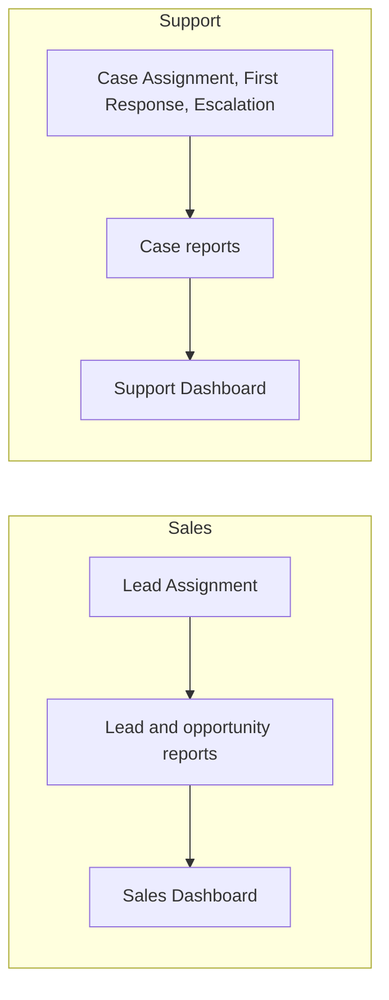
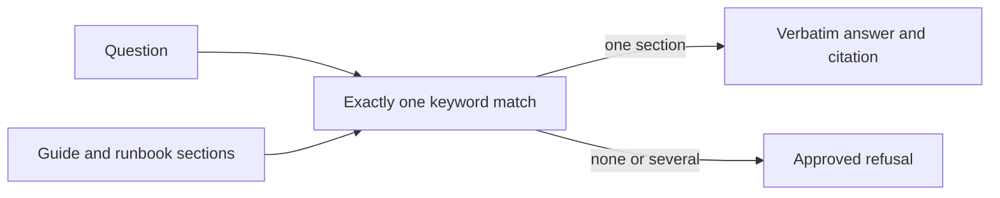

# Salesforce Org Operations and Release Management

Portfolio project for Salesforce functional operations across Sales Cloud and Service Cloud administration: personas, access, case and pipeline process, reporting, and a release path that fits Developer Edition.

Document date: 10 November 2026. Current milestone: M6. M1 through M5 are complete.

## Project Purpose

Show how an operations admin runs a small sales and support process across more than one org, with git as the source of truth.

The business scope is a sales rep qualifying leads and managing a pipeline, a first-line support agent handling cases, a second-line lead taking escalations, and an ops admin who controls access and releases. The technical scope is the Salesforce configuration and release discipline that make those jobs possible on Developer Edition.

## Scope

M1 delivers the operating foundation:

- Repository layout for a Salesforce DX project
- Four personas and twelve user stories
- Environment strategy for Org A, Org B, and scratch orgs
- Flosum access assessment
- Lifecycle Center assessment
- A validation script for this foundation

M2 delivers the configuration for REQ-001 through REQ-012:

- Custom fields and the Lead, Opportunity, and Case picklist values from the process contract
- Page layouts for Sales Rep, Support Agent L1, Support Lead L2, and Ops Admin
- Lightning record pages for Lead, Opportunity, and Case
- Six validation rules

Still out of scope:

- Flosum deployments. Access remains Not Executed.

`release/` holds the M5 process. The pipeline has not been created. `helper/` answers only from the user guides and runbooks.

## Architecture



| Path | Role |
| --- | --- |
| `force-app/` | M2 through M4 metadata: fields, automation, security, reports, and dashboards. |
| `manifest/package.xml` | M4 members, API 68.0. |
| `config/project-scratch-def.json` | Developer-edition scratch definition. No scratch org has been created. |
| `docs/` | Foundation, configuration, automation, security, reporting, release, and support notes. |
| `org-ops/` | Org alias registry. No credentials. |
| `release/` | M5 checklists, changelog, rollback drill, and release manifests. Not executed. |
| `helper/` | Advisory retrieval assistant. It does not call Salesforce. |
| `tests/validate-m1.ps1` | Checks the M1 foundation. |
| `tests/validate-m2.ps1` | Checks M2 fields, rules, traceability, and layouts. |
| `tests/validate-m3.ps1` | Checks M3 flows, permission sets, profiles, and the security matrix. |
| `tests/validate-m4.ps1` | Checks M4 reports, dashboards, synthetic data, and metric checks. |
| `tests/validate-m5.ps1` | Checks M5 checklists, changelog, rollback drill, and release traceability. |
| `tests/validate-m6.ps1` | Checks M6 guides, runbooks, and the procedure assistant. |

Detail and the limit tables: [docs/environment_strategy.md](docs/environment_strategy.md).

## Current Status

M1 through M5 are complete. M6 user guides, runbooks, and the advisory assistant are in source. Nothing has been deployed. Validation is `tests/validate-m1.ps1` through `tests/validate-m6.ps1`.

| Item | Status |
| --- | --- |
| Org A | Not connected |
| Org B | Not connected |
| Scratch org | Not created |
| Dev Hub | Not enabled |
| Lifecycle Center | Process documented in M5. Not installed or configured |
| Flosum | Not Executed |
| Metadata | M2, M3, and M4 source is in the repository. Deploy not run. Flows are Draft. Reports and dashboards have not been rendered. |
| Git remote | Not configured |

## Roadmap

| Milestone | Focus | Status |
| --- | --- | --- |
| M1 | Orgs, personas, requirements, environment strategy, Flosum assessment, Lifecycle Center assessment, git layout | Complete |
| M2 | Fields, page layouts, Lightning record pages, validation rules | Complete |
| M3 | Flows, minimum-access profiles, permission sets, permission set groups | Complete |
| M4 | Reports, dashboards, synthetic data, metric checks | Complete |
| M5 | Release governance for the scratch org, Org B, and Org A | Complete. Documented. Not executed |
| M6 | User guides, runbooks, and the advisory how-to assistant | Current |

M6 is the user-support milestone named for this portfolio. The release pipeline has not been created.

## Developer Edition Constraints

The edition in use is Developer Edition. Org A is a production stand-in. Org B is a UAT stand-in. Neither org is a sandbox, and neither is a customer production org.

Constraints that bind every later milestone:

- No sandboxes and no sandbox refresh. Change sets cannot tie Org A to Org B.
- Source tracking works on scratch orgs only. Org A and Org B take explicit deploys.
- Dev Hub allocations after enablement: 3 active scratch orgs and 6 creations per rolling 24 hours.
- Standard license picture to confirm on Company Information: 2 Salesforce CRM users, 3 Platform users, 0 Service Cloud users, 5 MB data storage, 20 MB file storage, 15,000 API requests per 24 hours.
- Four personas share those two CRM licenses. They are roles.
- Case management in the requirements uses standard Case. Features that need a Service Cloud user license are out of reach until a license exists.
- Lifecycle Center is available and unconfigured. Flosum access is Not Executed.
- A Developer Edition org can be deactivated after a year of inactivity. A deactivated Dev Hub drops the scratch orgs created from it.

The full tables and sources are in [docs/environment_strategy.md](docs/environment_strategy.md).

## Repository map

```
.
├── README.md
├── sfdx-project.json
├── .gitignore
├── .forceignore
├── .gitattributes
├── config/
│   └── project-scratch-def.json
├── manifest/
│   └── package.xml
├── force-app/
│   ├── README.md
│   └── main/default/
├── docs/
│   ├── personas.md
│   ├── requirements.md
│   ├── environment_strategy.md
│   ├── flosum_access.md
│   ├── lifecycle_center_notes.md
│   ├── data_model.md
│   ├── layout_strategy.md
│   ├── validation_rules.md
│   ├── test-cases.md
│   ├── requirement_traceability.md
│   ├── flows.md
│   ├── profile_strategy.md
│   ├── persona_testing.md
│   ├── security-matrix.xlsx
│   ├── reports.md
│   ├── dashboards.md
│   ├── metric_validation.md
│   ├── release_management.md
│   ├── release_governance.md
│   ├── support_model.md
│   ├── ai_helper.md
│   └── ai_helper_evaluation.md
├── data/
│   └── synthetic/
├── org-ops/
│   └── README.md
├── release/
│   ├── README.md
│   ├── CHECKLIST.md
│   ├── CHANGELOG.md
│   ├── release-plan.md
│   └── rollback-drill.md
├── helper/
│   ├── README.md
│   ├── ingest.py
│   ├── ask.py
│   ├── tests/
│   └── eval/
├── project_completion.md
├── release_notes_v1.0.md
├── future_roadmap.md
├── portfolio_summary.md
└── tests/
    ├── validate-m1.ps1
    ├── validate-m2.ps1
    ├── validate-m3.ps1
    ├── validate-m4.ps1
    ├── validate-m5.ps1
    └── validate-m6.ps1
```

## Validate M1

From the repository root:

```
powershell -NoProfile -ExecutionPolicy Bypass -File tests/validate-m1.ps1
```

The script checks that four personas exist with the required sections, that the requirement count is between 10 and 15 and the stories carry the required fields, that each foundation document is present, and that the environment strategy contains Mermaid diagrams.

## M2 Status

M2 is in source and has not been deployed. The Salesforce CLI is not installed here, so no scratch org was created and nothing was pushed to Org A or Org B.

| Area | State |
| --- | --- |
| Fields and standard value sets | Written for the M1 process contract |
| Layouts | One set per persona that uses the object |
| Lightning record pages | Lead, Opportunity, and Case, with dynamic visibility |
| Validation rules | Six active rules, with manual pass and fail examples |
| Flows, security, reports, dashboards, release, helper | Not in this milestone |
| Org deploy | Not run |

## Configuration Summary

Eight custom fields carry the data the standard objects do not already store: product interest, next step, first response, escalation reason, escalated by, return guidance, resolution notes, and a user persona label.

Lead Status, Opportunity Stage, and Case Status match the process contract. Six validation rules block an unqualified conversion, a lead with no email or phone, a Closed Won opportunity without a positive amount, an escalation without a reason and a user, a return to L1 without guidance, and a closed case without resolution notes.

Persona layouts limit which business fields each role sees. `User.Persona__c` drives Lightning visibility. It does not grant access. Object and field access is in [docs/profile_strategy.md](docs/profile_strategy.md) and [docs/security-matrix.xlsx](docs/security-matrix.xlsx). Reporting is in [docs/reports.md](docs/reports.md).

## Metadata Categories

| Category | Members |
| --- | --- |
| Custom fields | `Lead.Product_Interest__c`, `Opportunity.Next_Step__c`, `Case.First_Response_At__c`, `Case.Escalation_Reason__c`, `Case.Escalated_By__c`, `Case.Return_Guidance__c`, `Case.Resolution_Notes__c`, `User.Persona__c` |
| Standard value sets | `LeadStatus`, `OpportunityStage`, `CaseStatus` |
| Validation rules | `Lead_Requires_Email_Or_Phone`, `Lead_Convert_Requires_Qualified`, `Opportunity_Closed_Won_Requires_Amount`, `Case_Escalation_Requires_Reason`, `Case_Close_Requires_Resolution`, `Case_Return_Requires_Guidance` |
| Layouts | Sales Rep lead and opportunity, L1 case, L2 opportunity and case, Ops Admin lead, opportunity, case, and user |
| Lightning record pages | `Lead_Record_Page`, `Opportunity_Record_Page`, `Case_Record_Page` |

```
powershell -NoProfile -ExecutionPolicy Bypass -File tests/validate-m2.ps1
```

## M3 Status

M3 is in source and has not been deployed. The four flows are Draft. Flow tests are metadata only and have not been run.

| Area | State |
| --- | --- |
| Lead Assignment | Routes by Product Interest to a named owner placeholder |
| Case Assignment | Routes a new case to the L1 or L2 queue by priority and type |
| First Response Tracking | Stamps First Response At once when status leaves New |
| Escalation | Scheduled path, one day, then Escalated plus an Ops Admin notification |
| Profiles | Minimum-access shells: app and page layout only |
| Permission sets | Sales_Rep, Support_L1, Support_L2, Ops_Admin |
| Permission set groups | One group per persona |
| Security matrix | `docs/security-matrix.xlsx` |
| Reports, dashboards, release, helper | Not in this milestone |

Detail is in [docs/flows.md](docs/flows.md), [docs/profile_strategy.md](docs/profile_strategy.md), and [docs/persona_testing.md](docs/persona_testing.md).

```
powershell -NoProfile -ExecutionPolicy Bypass -File tests/validate-m3.ps1
```

## Reporting Architecture

Reports and dashboards are source metadata in two public read-only folders, Sales Leadership and Support Leadership. They sit on standard Lead, Opportunity, and Case report types and on the fields M2 and M3 already store. No report-only object was added.



A Sales Rep runs reports through `Reporting_Sales`. Support Lead L2 runs them through `Reporting_Support`. Ops Admin manages them through `Reporting_Admin`. Support Agent L1 has no reporting permission set. Both dashboards run as the logged-in user.

The hand-counted dataset is `data/synthetic/`. It is not loaded.

## Business Insights

These figures are the synthetic book, not a live org.

Sales leadership can see 221,000 of open opportunity amount across 13 open deals, and a 41.67% lead conversion rate once the ten conversion targets are converted. Web is the largest source, 10 of 24 leads. Eleven opportunities close in November 2026, for 212,000. Pipeline By Stage shows only the running user's own opportunities, which is the forecast conversation in REQ-009.

Support leadership can see 15 open cases, 7 of them High, and 4 escalations. The sixteen cases that left New average 3.00 hours to first response. Five cases are closed, split across the logical owners in the case file. L1 is not the audience for this all-team view.

## Dashboard Strategy

Each dashboard uses the same three component kinds: KPI metrics on the top row, charts for the grouped questions, and a table for the row-level question. Sales filters by stage on the pipeline chart and the closing-this-month table. Support filters by priority on every component. Folders stay public and read-only so folder sharing does not depend on a user id. Access is the permission set on the persona group.

Detail, the component inventory, and the hand checks: [docs/reports.md](docs/reports.md), [docs/dashboards.md](docs/dashboards.md), and [docs/metric_validation.md](docs/metric_validation.md).

## M4 Status

M4 is in source and has not been deployed. Dashboard values have not been read from an org.

| Area | State |
| --- | --- |
| Sales reports | Five reports, including the running-user pipeline and the conversion formula |
| Support reports | Five reports, including the status-and-priority matrix and the first-response formula |
| Dashboards | Sales Dashboard and Support Dashboard |
| Synthetic data | 24 leads, 18 opportunities, 20 cases, 4 escalations |
| Metric checks | Two hand counts per dashboard. Dashboard value is not observed |
| Release, Lifecycle Center, Flosum, helper | Not in this milestone |

```
powershell -NoProfile -ExecutionPolicy Bypass -File tests/validate-m4.ps1
```

## M5 Status

M5 is the release process. It is written and it has not been run. Path B is Lifecycle Center and git. Flosum stays Not Executed.

| Area | State |
| --- | --- |
| Release 1 | Operating process and access. Manifest only. Not deployed. |
| Release 2 | Reports and dashboards. Manifest only. Not deployed. |
| Pipeline | Three stages documented: scratch org, Org B, Org A. Not created. |
| Org B as a Lifecycle Center stage | Still an open check. No connection was attempted. |
| Rollback | Tabletop drill for Release 2. Not executed. |
| Flosum | Not Executed. Not in the pipeline. |
| AI helper | Not in this milestone |

Detail is in [docs/release_management.md](docs/release_management.md), [docs/release_governance.md](docs/release_governance.md), and [release/README.md](release/README.md).

```
powershell -NoProfile -ExecutionPolicy Bypass -File tests/validate-m5.ps1
```

## User Support Model

A person starts on the sales guide or the support guide. Each task is one page, with numbered steps, an expected outcome, and a troubleshooting note. A short quick-reference table sits at the end of each guide.

If the task is a broken login, a missing row, report access, or case ownership, the L1 runbook is next. Each L1 entry has a symptom, checks, a resolution, and escalation criteria. L2 is for flow faults, validation rules, permission-set mismatches, release failures, data corrections, and reporting discrepancies. Ops Admin is the stop for user administration and promotion.

The assistant may quote a page. The person still does the work. Two CRM licenses mean the four personas are tested one login at a time.

## AI Assistant Architecture

The assistant retrieves. It does not generate a procedure.



`helper/ingest.py` builds section ids such as `L1:Login Problems` and `SalesRep:Lead Qualification`. `helper/ask.py` returns that section only when its keyword phrase is the only match. Otherwise it returns the approved refusal and recommends escalation. The program does not call Salesforce.

## Knowledge Management Strategy

The approved procedures are the markdown pages under `docs/user-guides/` and `docs/runbook/`. A new answer is a new section with a stable id and a `Keywords:` line, not a change to the retriever. The assistant does not read the rest of the repository, so a fact that lives only in a design note is not an answer.

Review a new section the same way as a support macro: one symptom, one resolution, and an escalation line. Then add a covered question to `helper/eval/questions.json` or leave the topic uncovered on purpose and expect a refusal. Re-run `helper/tests/test_helper.py`. Do not point the assistant at an org, and do not let it deploy.

Detail is in [docs/support_model.md](docs/support_model.md), [docs/ai_helper.md](docs/ai_helper.md), and [docs/ai_helper_evaluation.md](docs/ai_helper_evaluation.md).

## M6 Status

M6 is in source. The assistant was scored locally. It was not connected to Salesforce.

| Area | State |
| --- | --- |
| Sales Rep guide | Four task pages plus a quick reference |
| Support Agent guide | Four task pages plus a quick reference |
| L1 runbook | Seven entries, each with symptom, checks, resolution, and escalation |
| L2 runbook | Six entries, in the same shape |
| Assistant | 23 sections. 20 of 20 covered questions cited the expected page. 10 of 10 uncovered questions were refused. 0 hallucinations |
| Salesforce changes by the assistant | None |
| Flosum and release execution | Unchanged. Not executed |

```
powershell -NoProfile -ExecutionPolicy Bypass -File tests/validate-m6.ps1
```
