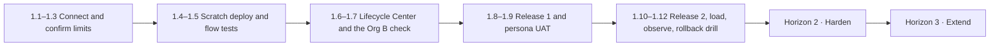

# Roadmap

**Salesforce Org Operations & Release Management** · from version 1.0 · 10 November 2026

Version 1.0 is complete as a source portfolio. M1 through M6 are delivered, nothing is deployed, and no org is connected. This roadmap turns the documented processes into recorded evidence, then hardens and extends the work. None of the items below have been started.

---

## Where v1.0 stands

| Area | v1.0 state | Evidence label |
| --- | --- | --- |
| Personas, requirements, traceability | Complete | Implemented + Documented |
| Configuration (fields, value sets, rules, layouts, pages) | In source | Implemented |
| Automation (4 flows, 7 flow tests, queues) | In source, Draft, tests not run | Implemented |
| Security (profiles, 7 permission sets, 4 groups) | In source | Implemented |
| Reporting (10 reports, 2 dashboards, synthetic data) | In source, not rendered, not loaded | Implemented |
| Release governance | Plan, gates, checklists, manifests, tabletop rollback | Documented |
| Support (guides, runbooks, retrieval assistant) | Complete, evaluated locally | Implemented |
| Lifecycle Center | Not installed | Studied |
| Flosum | Not Executed | Studied (public descriptions only) |

---

## Horizon 1: Make it real (connect, promote, observe)

Goal: replace every "Not executed" or "Not observed" with dated evidence.

| # | Item | Done when | Notes |
| --- | --- | --- | --- |
| 1.1 | Install the Salesforce CLI and authorize Org A and Org B on `login.salesforce.com` | Both aliases are in `org-ops/README.md` with the connection date | No credentials in git |
| 1.2 | Confirm license and limit counts on Company Information | Recorded: CRM licenses, Platform licenses, Service Cloud licenses, storage, API | Expected 2 / 3 / 0 / 5 MB / 15,000 |
| 1.3 | Enable Dev Hub on Org A and read the scratch-org limits | `sf limits api display` output saved | 3 active, 6 per 24 hours expected |
| 1.4 | Create the first scratch org and deploy the full source | Deploy ID recorded. Validation-rule examples run (36) | First proof the metadata is accepted |
| 1.5 | Run the 7 flow tests in the scratch org | `sf flow run test` results recorded | Before any activation |
| 1.6 | Turn on Lifecycle Center on Org A, connect GitHub.com or Bitbucket Cloud, create project `Org Operations` with one three-stage pipeline | Pipeline exists. Sandbox default stages removed | Assign only the product's own permission sets |
| 1.7 | **Try to attach Org B as the UAT stage** | Result written: success, or the exact product limitation | If rejected: CLI deploy of the same commit, with the limitation recorded |
| 1.8 | Promote **Release 1** through all seven gates (scratch → Org B → Org A) | Changelog has the deploy ID, SHA, approver, date, and outcome | Flows stay Draft |
| 1.9 | Run the persona tests on Org B, one persona at a time | Pass or fail per step for all four personas plus the control user | Two CRM licenses means sequencing |
| 1.10 | Promote **Release 2** | Changelog updated | Only after Release 1 passes |
| 1.11 | Load `data/synthetic/` with the flows Draft, render both dashboards | Four hand-checked metrics compared: 221,000 · 41.67% · 15 · 4 | Record "observed" values and the viewer |
| 1.12 | Run the Release 2 rollback drill for real on Org B | Destructive deploy result and validation steps recorded | Org A only if the drill is accepted |

## Horizon 2: Harden

Goal: close the known gaps in v1.0 and make validation repeatable.

| # | Item | Why |
| --- | --- | --- |
| 2.1 | Retrieve the target org's standard value sets before the first Release 1 deploy | The rollback drill can't restore picklist values that were never retrieved |
| 2.2 | Write and run a UAT procedure for the **Escalation scheduled path** | The flow test covers only the immediate path |
| 2.3 | Activate flows one at a time through new work items, UAT first | Activation is a behavioural change. Release 1 deliberately ships Draft |
| 2.4 | Deploy the intended org-wide defaults (Private: Lead, Opportunity, Case. Public Read Only: Account, Contact) through a work item | Documented but not in the source |
| 2.5 | Make the validation scripts cross-platform (PowerShell 7 or a Python runner) and run them in CI | The current scripts are Windows PowerShell |
| 2.6 | Add a check that the README status table matches `project_completion.md` | The repository README listed M6 as "Current" while v1.0 was recorded complete |
| 2.7 | Record the validate-m6 pass count in the completion report | Only m1–m5 counts are recorded |
| 2.8 | Promote average first response (3.00 hours) to a formal dashboard check | It's currently a supplementary figure |
| 2.9 | Expand the assistant's evaluation set with paraphrased covered questions and more uncovered ones | Measures recall honestly without loosening the matcher |

## Horizon 3: Extend (one requirement per work item)

| # | Item | Guardrail |
| --- | --- | --- |
| 3.1 | New stories, each as its own work item (REQ-013 onward) | Don't bundle unrelated changes into Release 1 or Release 2 after they have a deploy ID |
| 3.2 | Additional guide tasks and runbook entries as support questions recur | One symptom per entry. Add or adjust the evaluation set for each |
| 3.3 | A third Developer Edition org as a dedicated Dev Hub, if release and scratch administration need separating | Keep the three-stage pipeline. Don't invent a sandbox |
| 3.4 | Service Cloud license-dependent features (Entitlements, milestones, Omni-Channel) | **Only if** Company Information shows Service Cloud user licenses |

---

## Permanently closed (unless the facts change)

These aren't backlog items. They're boundaries the project keeps.

- **Flosum** stays Not Executed until a real tenant exists. Don't describe a Flosum pipeline before then.
- **No sandbox** will be added, and neither Developer Edition org will be called a customer production org.
- **The assistant** won't be extended to deploy, assign permissions, edit records, or answer from outside the guides and runbooks.
- **No Modify All Data**, including as a shortcut to close a ticket.
- **No force push** and no direct commit to `main`.

---

## Sequencing

## Risks to the roadmap

| Risk | Impact | Response |
| --- | --- | --- |
| Org B can't be attached as a Lifecycle Center stage | UAT hop not governed by the product | CLI deploy of the same commit, limitation recorded |
| License counts differ from the documentation | Persona plan changes | Re-map personas to the licenses that actually exist before UAT |
| A standard value set deploy fails on existing data | Release 1 blocked | Fresh scratch org first. Retrieve and reconcile values (2.1) |
| API budget spent by retries | Day-long stall | Stop retry loops as calls approach 15,000 |
| Org A deactivated after a year of inactivity | Dev Hub and scratch orgs lost | Login cadence on the operator checklist |
