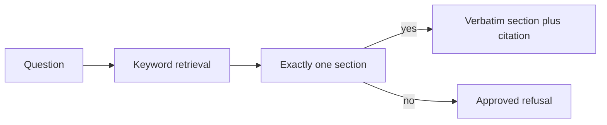

# AI helper

The helper is a document retrieval assistant. It answers a how-to question only when one procedure section matches. It is advisory. It does not change Salesforce data, assign permissions, modify configuration, deploy releases, or trigger automation.

## Architecture



`helper/ingest.py` reads `docs/user-guides/` and `docs/runbook/`. It splits each file on `##` headings. The heading is the section id, for example `L1:Login Problems` or `SalesRep:Lead Qualification`. The `Keywords:` line under the heading is the only match text. The rest of the section is the answer.

`helper/ask.py` folds the question and looks for those keyword phrases. It returns the section body only when exactly one section matches. Zero matches, or two matches, are a refusal. The answer text is copied from the section. It is not rewritten.

A citation is the section id. The id is present in the index because the answer was taken from that section.

## Guardrails

If the question does not match one approved section, the reply is:

```
This runbook does not contain
an approved answer.

Recommend escalation.
```

The helper does not add a guessed step under that message. A synonym that is not one of the keyword phrases is a refusal. That is intentional. Guessing a nearby page would invent a procedure.

The code does not call the Salesforce CLI, an HTTP client, or a library that logs into an org. Quoting a runbook page that tells a person to ask Ops Admin is not the same as the assistant assigning a permission or deploying a release.

## How to run it

From the repository root:

```
py -3 helper/ingest.py
py -3 helper/ask.py "How do I qualify a lead?"
py -3 helper/eval/run_eval.py
```

`ask.py` reads the markdown on each question. `helper/index.json` is a copy of that index for inspection. The evaluation set is `helper/eval/questions.json`.
