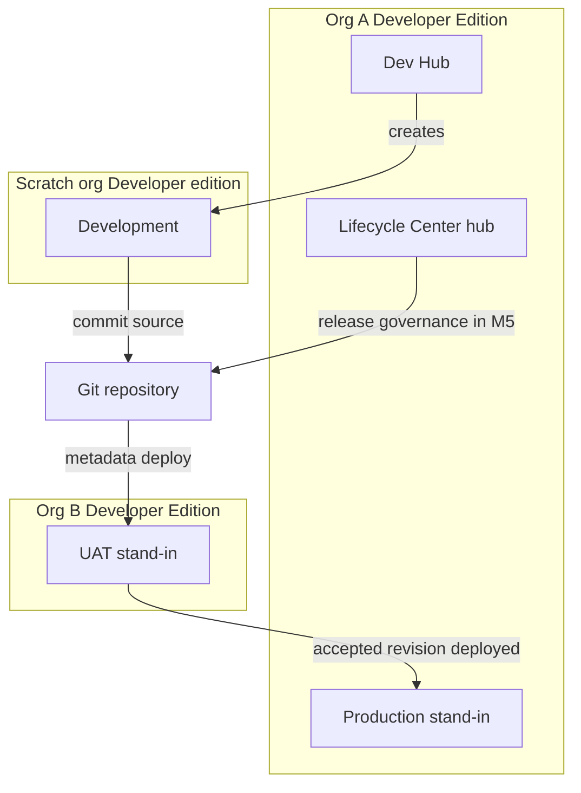
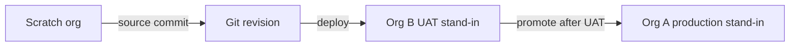

# Environment strategy

This project uses two independent Developer Edition orgs and short-lived scratch orgs. Org A stands in for production and also hosts the Dev Hub and Lifecycle Center. Org B stands in for UAT. Scratch orgs are the only development environment, because Developer Edition orgs do not support source tracking.

No org is authenticated in M1. No scratch org has been created. Aliases below are planned names, not live connections.

## Claims boundary

| Topic | Statement |
| --- | --- |
| Edition | Developer Edition |
| Org A | Production stand-in, Dev Hub, and Lifecycle Center hub for this portfolio project |
| Org B | UAT stand-in |
| Scratch org | Development, edition shape Developer |
| Sandboxes | None |
| Customer production org | Not part of this project |
| Flosum | Not Executed |
| Lifecycle Center | Treated as available. Not installed or configured in M1 |

Login host for Org A and Org B is `https://login.salesforce.com`. Sandbox login (`test.salesforce.com`) does not apply.

## Org A

Roles:

- Production stand-in. This is the last org a change reaches after UAT. It is not a customer production org.
- Dev Hub. Scratch orgs are created from Org A. Salesforce documents that a Developer Edition org can enable Dev Hub, with three active scratch orgs and six successful creations in a rolling 24 hours.
- Lifecycle Center hub. The product is available in Developer Edition. Installation and pipeline setup wait until M5.

Source tracking is not supported on a Developer Edition org. Metadata moves into Org A by an explicit deploy from git, not by `source pull` tracking.

If Org A is later deactivated for inactivity, scratch orgs and any package versions tied to that Dev Hub go with it. Salesforce Help documents deactivation of a Developer Edition org after one year of inactivity. Log in on a regular schedule once the org exists.

## Org B

Role: UAT stand-in.

Org B is a second Developer Edition org. It is not a sandbox of Org A. It cannot be refreshed from Org A. Change sets cannot link the two orgs, because change sets travel between a production org and its sandboxes.

UAT means a named reviewer runs the persona stories against metadata deployed from a known git revision. Data storage on the org is 5 MB, so UAT data stays tiny.

Whether Lifecycle Center can attach Org B as a pipeline stage is an M5 check. The check is recorded as open in the Lifecycle Center notes. Until that check passes, promotion into Org B is a CLI metadata deploy of the same git revision.

## Scratch org

Role: Development.

The scratch definition is [config/project-scratch-def.json](../config/project-scratch-def.json). The edition value is `Developer`. Features are empty. Sample data is off. No scratch org is created in M1.

Scratch orgs always support source tracking. That is why development happens there and not inside Org A or Org B. Default lifespan is 7 days. Maximum lifespan is 30 days. Scratch org storage is 500 MB of data and 50 MB of files, which is larger than the parent Developer Edition org and still finite.

A Developer-edition scratch org includes two Salesforce user licenses. One is the default admin. One additional standard user can be created. Four personas still cannot each have a simultaneous CRM login inside one scratch org.

Daily and active allocations are counted on the Dev Hub (Org A), not on Org B.

## Promotion path

The path below is the target. M1 does not deploy, commit a release branch, or promote anything.

1. Build in a scratch org created from Org A.
2. Commit the metadata to this git repository.
3. Deploy that revision to Org B and run the relevant user stories.
4. Deploy the accepted revision to Org A.

Lifecycle Center is the control plane documented in M5. The pipeline has not been created. Git remains the source of truth either way.

## Diagrams

Role map:

Promotion path:

## Developer Edition limits

Figures are from Salesforce documentation cited below. Re-check Company Information and `sf limits api display` when Org A is connected. Signup programs can differ.

| Limit | Developer Edition org (Org A and Org B) |
| --- | --- |
| Sandboxes | None |
| Data storage | 5 MB |
| File storage | 20 MB |
| API requests | 15,000 per 24 hours |
| Salesforce CRM user licenses | 2 |
| Salesforce Platform user licenses | 3 |
| Service Cloud user licenses | 0 |
| Source tracking | Not supported |
| Dev Hub | Can be enabled. Not enabled in M1 |
| Active scratch orgs, once Dev Hub is enabled | 3 |
| Scratch org creations per rolling 24 hours | 6 |
| Inactivity | Deactivation after one year, per the Salesforce Help comparison |
| Lifecycle Center | Available in Developer Edition. Not configured in M1 |

| Limit | Scratch org from this Dev Hub |
| --- | --- |
| Edition requested by this project | Developer |
| Data storage | 500 MB |
| File storage | 50 MB |
| Lifespan | 7 days default, 30 days maximum |
| Source tracking | Supported |
| Salesforce user licenses | 2 |

Service Cloud administration in this project means the Case process in REQ-005 through REQ-008, using standard Case behavior a Developer Edition org provides. Entitlements, milestones, Omni-Channel, and other features that require a Service Cloud user license are outside the license set documented for Developer Edition. Do not design those features until Company Information shows a license for them.

Platform user licenses do not replace the two CRM licenses for Lead, Opportunity, and Case work.

## What M1 leaves unconnected

- No Salesforce CLI auth files.
- No usernames in the repository.
- No Dev Hub enablement.
- No scratch org create command.
- No Lifecycle Center setup.
- No Flosum tenant.

The registry of planned aliases lives in [org-ops](../org-ops/README.md).

## Sources

- Salesforce DX Developer Guide, "Supported Scratch Org Editions and Allocations." Developer Edition or trial: 3 active scratch orgs and 6 daily. Scratch org storage: 500 MB data and 50 MB files. https://developer.salesforce.com/docs/platform/sfdx-dev/guide/sfdx-dev-scratch-orgs-editions-and-allocations.html
- Salesforce DX Developer Guide, "Manage Source Tracking for Your Org." Source tracking is not supported on Developer Edition orgs. Scratch orgs always support it. https://developer.salesforce.com/docs/atlas.en-us.sfdx_dev.meta/sfdx_dev/sfdx_dev_source_tracking_which_orgs.htm
- Salesforce DX Developer Guide, scratch org users. A Developer Edition org includes a maximum of two Salesforce user licenses.
- Salesforce Help, "Benefits of Using a Partner Development Org and Demo Environment." Developer Edition column: sandboxes not available, 5 MB data, 20 MB files, 15,000 API requests per 24 hours, 2 Salesforce licenses, 3 Salesforce Platform licenses, 0 Service Cloud licenses, deactivation after one year of inactivity. https://help.salesforce.com/s/articleView?id=000391959
- Salesforce Developers Blog, "Choose the Right Salesforce Org for the Right Job" (May 2024). Developer Edition can enable Dev Hub and can install DevOps Center. Developer Edition orgs are not source-tracked development environments, and they cannot create sandboxes. https://developer.salesforce.com/blogs/2024/05/choose-the-right-salesforce-org-for-the-right-job
- First-generation packaging guidance: a trial or Developer Edition Dev Hub is limited to six scratch orgs and package versions per day and three active scratch orgs. If that Dev Hub org expires, packages associated with it are lost.
