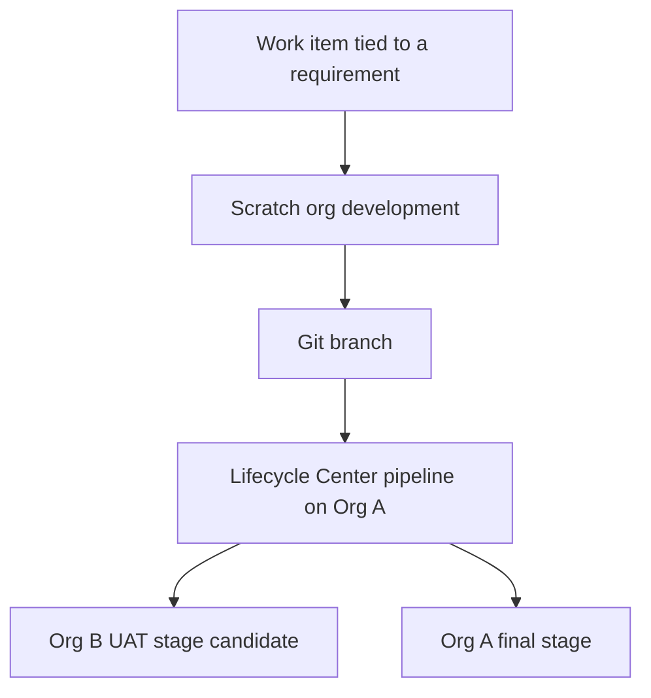

# Lifecycle Center notes

Assessment date: 10 November 2026.

Lifecycle Center is treated as available. Salesforce Help lists it for Lightning Experience in Professional Edition (with API access), Enterprise, Performance, Unlimited, and Developer Editions. Current Help uses the name Lifecycle Center. Earlier docs and some setup screens say DevOps Center. This project uses Lifecycle Center for that product.

M1 does not enable Dev Hub, does not open Lifecycle Center, and does not create a project, pipeline, work item, or git remote.

## Purpose

Lifecycle Center is the release-control plane for this portfolio.

- A work item collects the metadata for one change.
- A pipeline is an ordered set of stages.
- Each stage points at a Salesforce org and a branch.
- Git holds the metadata. An org is a place the metadata is built or verified, not the source of truth.

That model replaces change sets. Change sets are unavailable between Org A and Org B anyway, because those orgs are not a production org and a sandbox.

In this project the control plane lives on Org A, which is also the Dev Hub and the production stand-in.

## Architecture

Salesforce's data model for the product is a project that contains one pipeline, work items, pipeline stages, and environments. An environment is a Salesforce org. Work items, stages, and environments stay inside a single project.

Planned shape for this repository:

| Piece | Where it lives | M1 state |
| --- | --- | --- |
| Lifecycle Center hub | Org A | Not installed |
| Dev Hub | Org A | Not enabled |
| Development environment | Scratch org with source tracking | Not created |
| UAT environment | Org B | Not connected. Stage attachment is an M5 check |
| Final stage | Org A, in its production stand-in role | Not connected |
| Source of truth | This Salesforce DX repository | Local structure only. No remote |

Org A and Org B do not support source tracking. Scratch orgs do. Development environments for Lifecycle Center are therefore scratch orgs. Changes that must land on Org A or Org B are explicit deploys. Salesforce's own guidance allows changes from orgs without source tracking to be added and committed manually, and recommends source-tracked development environments so changes are detected.

One open M5 check: can a second, unrelated Developer Edition org be attached as a UAT stage? Sandboxes are the usual non-scratch stage, and this project has none. If Org B cannot be attached, UAT remains a CLI deploy of the git revision the work item already committed, and Lifecycle Center still owns the work item and the final stage on Org A.

## Git Integration

Lifecycle Center expects a Salesforce DX repository with `sfdx-project.json` at the root. This project is that shape. `sourceApiVersion` is 68.0 (Winter '27).

Documented source-control providers are GitHub.com, including GitHub Enterprise Cloud, and Bitbucket Cloud. Salesforce Help for connecting source control names GitHub and Bitbucket. GitLab, Azure DevOps Repos, and self-hosted GitHub Enterprise Server are outside that documented set. This project did not connect any provider, so the unsupported-provider statement is from published setup guidance, not from a failed connection attempt.

M1 remote status: not configured. No pipeline repository has been created by Lifecycle Center. No OAuth grant to GitHub or Bitbucket exists in this workspace.

When a remote is added later, it should be one of the two documented providers, and it should contain this same DX layout. Branch names and stage mapping belong to M5.

## Developer Edition Support

| Question | Answer used by this project |
| --- | --- |
| Can Lifecycle Center run in Developer Edition? | Yes. Salesforce Help includes Developer Edition in the available editions. It is not configured here. |
| Can the Dev Hub be a Developer Edition org? | Yes. Allocations are 3 active scratch orgs and 6 per rolling 24 hours. |
| Can Org A be the development environment? | No. Developer Edition orgs do not support source tracking, and Salesforce has said they are not the development environment for this tooling. |
| Can a sandbox be a stage? | Not in this project. Sandbox count is zero. |
| Can a scratch org be the development environment? | Yes. That is the planned development role. |
| Does M1 prove any of this inside a live org? | No. Availability is taken from Salesforce Help and the DX guides. Execution starts in M5. |

Permission sets that Lifecycle Center adds, including an admin permission for setup, are assigned in M5. M1 assigns nothing. Opening the product requires the permissions Salesforce specifies at setup time, which include broad data visibility. That assignment waits until Org A is connected and the security milestone has a named admin.

A Developer Edition hub that sits inactive for a year can be deactivated. A deactivated Dev Hub takes its scratch orgs with it. M5 should record the Org A login cadence before any pipeline depends on it.

## Expected Usage In M5

M5 writes this release process and does not execute it. No org is connected, Dev Hub is not enabled, and Lifecycle Center is not installed. The steps below are still the execution list.

1. Enable Dev Hub on Org A and confirm scratch-org allocations with `sf limits api display`.
2. Turn on Lifecycle Center on Org A and assign the admin permission set to the named Ops Admin.
3. Connect a GitHub.com or Bitbucket Cloud remote that contains this repository.
4. Create one project and one pipeline for the Org A production stand-in.
5. Use a short stage list that matches the real topology: development in a scratch org, a UAT candidate on Org B, and a final stage on Org A. Drop any default stage that assumes a sandbox this project does not have.
6. Try to attach Org B as the UAT environment. Record success or the exact product limitation.
7. Run one work item mapped to a single requirement id. Commit from a scratch org. Promote only that revision.
8. If Org B is not a legal stage, deploy that same git revision to Org B with the CLI and write down that Lifecycle Center did not perform the UAT hop.
9. Keep Flosum out of the pipeline unless its access status changes from Not Executed.

M5 still does not invent a sandbox, an Enterprise org, or a production customer org in order to make the default pipeline diagram fit.

## Sources

- Salesforce Help, "Build Your Pipeline." Available in Developer Edition. A pipeline stage corresponds to an org and a branch. https://help.salesforce.com/s/articleView?id=platform.devops_center_build_pipeline.htm&type=5
- Salesforce Help, connecting source control. GitHub or Bitbucket. The same edition list includes Developer Edition.
- Salesforce DX Developer Guide, source tracking by org type, and scratch org allocations for Developer Edition.
- Salesforce Developers Blog, May 2024, "Choose the Right Salesforce Org for the Right Job." DevOps Center can be installed in a Developer Edition org and is not installed in a sandbox. Sandboxes and scratch orgs are the environments you connect. Developer Edition orgs themselves lack source tracking.
- Salesforce DevOps Center Developer Guide, data model: project, pipeline, pipeline stage, work item, and environment. An environment is a Salesforce org. A project has one pipeline.
