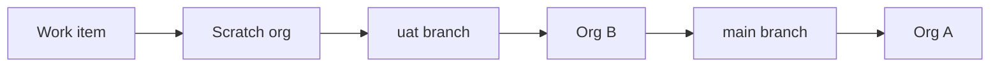

# Release management

Path B is the release path. Flosum access is Not Executed, so Path A is not in use. Branching, release branches, promotion, rollback, and review are not described as a Flosum process. Those topics stay closed until a real Flosum tenant exists. The access record remains [docs/flosum_access.md](flosum_access.md).

This process has not been executed. Lifecycle Center is not installed. Dev Hub is not enabled. No remote is connected.

## Project setup

When Org A is connected, the Ops Admin does the following and writes the result. None of these steps have been done.

1. Enable Dev Hub on Org A and read the scratch-org limits before creating an org.
2. Turn on Lifecycle Center in Org A. Assign only the permission sets the product installs to the named Ops Admin.
3. Connect a GitHub.com or Bitbucket Cloud repository that contains this Salesforce DX project. `sfdx-project.json` is already at the root, and `sourceApiVersion` is 68.0.
4. Create one project, `Org Operations`, and one pipeline. A Lifecycle Center project has one pipeline.
5. Record whether Org B can be attached as a stage. Sandboxes do not exist here. If the product rejects Org B, UAT stays a CLI deploy of the same git revision, and Lifecycle Center still owns the work item and the Org A stage.

## Pipeline

| Order | Stage | Branch | Environment |
| --- | --- | --- | --- |
| 1 | Development | Work item branch `wi/WI-00n-slug` | Scratch org created from Org A |
| 2 | UAT | `uat` | Org B, the UAT stand-in |
| 3 | Production Stand-In | `main` | Org A, the production stand-in |

Drop any default stage that points at a sandbox. Org A is not the development environment. Developer Edition orgs do not support source tracking. Scratch orgs do.

## Work items

WI-001 is Release 1, the operating process and access model. WI-002 is Release 2, the leadership reports and dashboards. Later work items carry one requirement id. The branch, review, UAT, approval, production promotion, validation, and rollback criteria are in [release/release-plan.md](../release/release-plan.md).

## Promotion flow

1. Build the change in a scratch org and commit it on the work item branch.
2. Review the diff into `uat`.
3. Promote to Org B and run the story checks.
4. Ops Admin approves in writing.
5. Merge `uat` into `main` and deploy that commit to Org A.
6. Run the post-deployment checks and record the outcome in [release/CHANGELOG.md](../release/CHANGELOG.md).

Release 1 deploys [release/manifests/release-1-package.xml](../release/manifests/release-1-package.xml). Release 2 deploys [release/manifests/release-2-package.xml](../release/manifests/release-2-package.xml) only after Release 1 has passed. The full [manifest/package.xml](../manifest/package.xml) remains the inventory of the repository. Promotions use the release manifest, not an unscoped deploy of every future file.

## Rollback via git revert

Rollback starts from a revert commit, not from a force push. The revert is the git record. The org changes only when a deploy runs.

A normal deploy will not delete components the bad commit added. Release 2 removal uses [release/rollback/destructiveChanges.xml](../release/rollback/destructiveChanges.xml) after the same removal is accepted on Org B. The drill, the trigger, and the metadata limits are in [release/rollback-drill.md](../release/rollback-drill.md).

## Requirement, metadata, release, validation

| Requirement | Metadata | Release | Validation |
| --- | --- | --- | --- |
| REQ-001 | Opportunity.Next_Step__c, OpportunityStage, Opportunity layouts and record page, Pipeline_By_Stage, Open_Opportunity_Value, Opportunities_Closing_This_Month | Release 1 for the field and stage. Release 2 for the three reports. | `validate-m2.ps1` for the field. `validate-m4.ps1` for the reports. |
| REQ-002 | OpportunityStage, Opportunity_Closed_Won_Requires_Amount | Release 1 | `validate-m2.ps1` |
| REQ-003 | LeadStatus, Lead.Product_Interest__c, lead validation rules, Lead_Assignment | Release 1 | `validate-m2.ps1`, `validate-m3.ps1` |
| REQ-004 | Lead_Convert_Requires_Qualified | Release 1 | `validate-m2.ps1` |
| REQ-005 | CaseStatus, Case layouts and record page | Release 1 | `validate-m2.ps1` |
| REQ-006 | Case.First_Response_At__c, First_Response_Tracking, First_Response_Performance | Release 1 for the field and flow. Release 2 for the report. | `validate-m3.ps1`, `validate-m4.ps1` |
| REQ-007 | Escalation reason, Escalated By, Escalation flow, L2 queue, Escalations_By_Priority | Release 1 for the flow and queue. Release 2 for the report. | `validate-m3.ps1`, `validate-m4.ps1` |
| REQ-008 | Return guidance, resolution notes, close and return rules, Cases_Closed_By_Agent | Release 1 for the rules. Release 2 for the report. | `validate-m2.ps1`, `validate-m4.ps1` |
| REQ-009 | Pipeline_By_Stage, Sales_Dashboard, Reporting_Sales | Release 2. The reporting permission set ships in Release 1 so the group can deploy. | `validate-m4.ps1` |
| REQ-010 | Cases_By_Status, Open_Cases_By_Priority, Support_Dashboard, Reporting_Support | Release 2. L1 still has no reporting set. | `validate-m4.ps1` |
| REQ-011 | Four profiles, four persona permission sets, four groups | Release 1 | `validate-m3.ps1` |
| REQ-012 | Ops_Admin permission set, User.Persona__c | Release 1 | `validate-m3.ps1` |

`validate-m5.ps1` checks this release package. It does not deploy it.
